# Friend-Pi 后续演进规划书

> 更新：本文保留修复前研究与竞品体验记录。用户后续批准的实施范围、已落地行为和前后示意见 [实施附录](../../implementation/2026-10-07/修复清单.md) 与 [最新产品对比](../../implementation/2026-10-07/comparison.html)。最新候选验收与本研究快照分开记录。

2026-10-07 · 本地候选核验与竞品体验 · 19 个可分别决策的优化点

**当前已开发能力的完备性尚未通过。** 本轮重跑原有95项测试、类型检查与制品摘要复核通过，但独立需求探针/harness确认13项缺口。核心Single、Swarm、Expert、Memory和ReBuild路径确实存在，不能把‘存在并能完成小任务’当作‘原计划所有边界已完备’。建议先修原承诺，再选择体验增强。本文只交付核验与演进方案，没有执行这些演进。

主界面继续使用浅色Friend布局：顶栏横向项目，左栏纵向会话与状态，中央对话和轮次侧轨，底部计划滑块及Single/Swarm，右上单一工作台入口，内部切文件/Diff/Swarm/Expert/Memory五页。设置承接启停、全库与长期管理；上下文后台维持，不设工作台页面。统一轻量工作台为用户已确定的方向（19），其余演进待选择。取消上下文页不算修复R01/R02，后台纠正和来源失效仍是首要修复项。当前预览、书签、拖动分栏已经实现，这里是增强方案，不重复宣称新开发。

## 阅读与决策

- [可交互规划书](index.html)：逐项看图、筛选优先级，选择‘采用/稍后/不做’，导出本地决策JSON。不会自动执行、联网或改变Friend-Pi配置。
- [19组图集](visuals/index.html)：每点都有优化前/后产品布局对比，SVG可放大，PNG可下载。
- [完整核验摘要](verification-summary.json)与[evidence/](evidence/)：原始报告、功能矩阵和强复现结果。
- 所有‘前’图是**固定候选的缩略示意和示例数据**，依据源码/实测构图；真实截图另列。所有‘后’图是**未实现方案**，不能当作开发完成证据。

## 固定候选与核验边界

| 项目 | 固定身份 / 结果 |
|---|---|
| 被核验业务源码 | `5ec4b39fb7301ac57715976458f602909fc0a0fb` |
| Pi | `eb326d265ae0b88489a6d10319307780df827cdf` |
| macOS app树SHA256 | `a066e009e9d073ee3f49fc5b0e73307da857d57d6b2a425cabd16e7fbc6097d4` |
| ZIP SHA256 | `62fcb20db6aed9edbcbd44e6f6c9d246528cfff3e07e2b792419f33c8c570375` |
| 当前app | `/Users/youdongliang/Desktop/Friend-Pi/.artifacts/mac/Friend-Pi.app` |
| 原有测试 | 新跑95/95与typecheck通过；Swarm/Expert43、Memory/ReBuild31属于既有覆盖子集，不累加成169 |
| 新正向边界 | 真实Git冲突保留、Expert回滚不可变版本；SQLite保存/遗忘故障原子回滚、跨会话原史查询，共5项通过 |
| 独立缺口 | 下表13项；source/harness、fake provider与真实GUI层级分别标明 |

根Agent本轮实际Friend-Pi旅程：新隔离项目、真实DeepSeek只读请求与流式结算；普通纠正→有效约束冲突；Memory候选采用/来源/纠正v3/版本/搜索/导出；Expert新建/编辑v2/回滚v3/停用及验证表单；自动拆分被非法范围拒绝、手动两只读成员整合、共享材料v1；原史搜索/前后文和小会话整理回退；文本文件预览与漏报Diff；轮次浮卡、319→251拖分栏、720×610窄屏、空闲Memory禁用/重新加载与业务数据保留。所有写入在本次自有测试项目或其插件业务记录，未修改原Friend或现有Pi配置，没有读/打印/转移API Key。

本轮未完整重做：真实图片模型旅程、Pi四类交互的确认/取消/超时GUI全组合、成员崩溃/合并失败的GUI全路径、真正长窗口多主题所有组合、每插件单独原生Pi GUI旅程。部分有现有同候选测试/前轮真实模型证据，但不能换算成本轮全GUI验收。新回归失败不会被旧报告里的localCandidateVerified盖过；也没有声称正式Acceptance。

## 确认缺口

P1/P2是缺陷严重程度；规划的P0/P1/P2是施工顺序，两套含义不同。CL-04旧提交回填目前仅源码风险，不纳入13项确认数。

| ID | 程度 | 现象 | 本轮证据 |
|---|---|---|---|
| SWARM-STOP-OBJECTIVE-CHECK | P1 | 停止后宿主检查继续执行 | 真实延迟Node进程探针 |
| SWARM-TARGETED-REWORK | P2 | 返工重跑未受影响任务 | 独立两任务控制器探针 |
| EXPERT-AUTO-TOOL-SCOPE | P2 | 自动采用与明确采用工具范围不一致 | 独立专家策略探针 |
| SWARM-SHARED-EVENT-COMMIT | P2 | 共享变更事件先于事务提交 | 双SQLite连接探针 |
| R02 | P1 | 纠正一个事实丢掉同来源无关约束 | Memory/ReBuild组合回归 |
| R01 | P2 | 普通更正仍同时保留新旧有效要求 | 组合回归及本轮真实GUI |
| M01 | P2 | 请帮我记住的中文表达误拒绝 | 独立明确偏好回归 |
| M02 | P2 | 跨会话前台未抢占另一后台调用 | 双活控制器回归 |
| M03 | P2 | 遗忘原史fork后换词事实重新成为候选 | 真实Pi fork与fake reflection回归 |
| CL-01 | P1 | 缺失原史静默替换索引 | 真实Main隔离VM/harness |
| CL-02 | P2 | Diff漏掉未跟踪文件 | 真实Git与本轮真实GUI |
| CL-03 | P2 | 冷恢复消息投影丢工具/多模态结构 | 真实Pi JSONL与SDK进程 |
| CL-05 | P2 | 默认Swarm和默认插件互相矛盾 | 实际Main隔离harness |

另有部分实现/增强边界：Dream语义去重、冲突/过期；专家结构化适用范围与非JSON客观基准；缺Expert时方法候选恢复补投；Plan陌生目录只读探索；已有suite读回编辑；Markdown常用结构、完整历史投影、长期设置归位。浏览器、交互终端、Team、侧聊、浮动多窗口、外部Agent后端、旧Friend迁移是首版排除项，不能作为首版开发缺陷计数。

原始核验：[客户端59条](evidence/client/client-completeness-matrix.json) · [Swarm/Expert28条](evidence/swarm-expert/coverage.json) · [Memory/ReBuild37条](evidence/memory-rebuild/requirement-coverage.json)。这些矩阵有交叉，不相加为独立功能数或通过率。

## 竞品体验与版本

调研先建完整功能地图，再访问可用客户端入口及小批真实旅程：MiniMax34、Reasonix28、Codex24、DSH26、ZCode24，共136条**按产品归类的功能条目**。这不是136条已跑通过的测试。每条标为资料、看到入口、过程核实、具体结果核实、加载中、受限或未执行；主报告不把按钮存在算执行通过。

| 产品 | 已安装版本 | 本轮实际体验 | 资料/源码边界 |
|---|---|---|---|
| MiniMax Code | 3.0.68 | 首页/项目选择、真实任务提交尝试、设置搜索/通用/个性化记忆/快捷键/审查/工作树/连接、插件/技能/MCP管理、自定义Agent表单、Schedule/Sites/Remote入口 | 新任务提交后未见可确认执行结果，插件/MCP/Sites持续加载；不猜网络原因。公开TUI/runtime `56221c121c6e63d0e50b68f57d4abf083afed119` 与桌面不同 |
| Reasonix | 1.38.6 | 隔离项目读取README+测试、一次工具批准、停止ask、正式Plan生成→审批→两文件改动+两测试通过、文件树→Markdown预览、多类设置与健康检查页面 | 精确标签 `e2145b031deef603d9ec1acc9d30f9a1e1ac9325`；当前repo Studio `63195e95a5b95c4b2c69481dea272fc4d5ce0bcd` 是另一条线。Diff点击未证明转变；多成员/rewind恢复全流程未完成 |
| DeepSeek Harness | 0.2.0-rc.2 | 首设向导跳过充值、隔离工作区真实只读测试、工具输入/输出EXIT=0、Plan菜单→右全文审批→批准执行→两文件改动+两测试通过、两只读成员协作/谱系/成员原会话、通用/模型/插件/Agentpreset | 初始充值提醒不等于无额度，现有配置确实能运行。本机代码工作视图未启用，未改用户设置，专门Trajectory及Changes未体验。源码 `5badb15009ae1756c3afe0ae0cef1faafc290ccc` 所属版本0.2.1-alpha.1与装机不同，完整SHA见来源记录 |
| Codex desktop | 26.1002.51308 | 本轮Computer Use明确禁止访问自应用；仅使用用户给定轮次预览截图、官方资料与公开源码 | 没有绕过限制，没有GUI通过声明。公开CLI/backend `afb436df8b70bb5bc57b86d9a3e829968988cd21` 不等于闭源desktop；官方旧Codex文档重定向统一ChatGPT/Codex，新增Work/dots不自动算装机功能 |
| ZCode | 3.14.3 | 跳过登录后查看模型、外观、浏览器/电脑控制、快捷键、记忆、子Agent、插件、MCP、技能、命令、Hooks，共12页；未改已有草稿 | 未配置可执行模型，本轮无真实任务。源 `29628c9acdb81b703bbd4080c207a0e7ce5e276e`；Computer Use公开NOTICE为占位，看到设置不能当作真系统控制；记忆页本机实际存在，与旧官网‘无管理UI’不同 |

Reasonix与DSH的批准后实现均被根Agent独立再跑Node24测试和Git差异验证：各2/2测试、仅index.js/test.mjs，+2/−1。[独立结果](evidence/competitor-independent-results.json)。它证明这些夹具的happy path，不证明产品所有组合正确。

功能全集与逐项范围：[MiniMax/Reasonix地图](evidence/research/minimax-reasonix/research-notes.md) · [62条体验覆盖](evidence/research/minimax-reasonix/hands-on-coverage-draft.md) · [Codex/DSH/ZCode地图](evidence/research/codex-dsh/research.zh.md) · [74条体验覆盖](evidence/research/codex-dsh/hands-on-coverage-draft.md)。远程/手机配对、IM外发、充值、发布、购买、额外系统权限和新凭证配置只研究入口，未执行。没有把同名Ocean装机应用映射成未经核实的社区主题项目，后者仅保留额外开源参考。

## 产品取舍与依赖顺序

1. **A：原承诺修复门槛。** 01–08先做；09定向返工、10事件顺序、11只读探索、16配置依赖、17suite读回里的既有承诺修补也应提前，不能因放在增强组就延后。所有13回归先转绿，再选体验扩张。
2. **B：日常开发主流程。** 03/04的消息与变更为基础，完成11计划审批、12会话待处理、15文件材料、16设置归位。每项独立可用，避免等待整套大改才交付。
3. **C：四能力可解释性。** 09任务图与定向返工、10共享冲突、17专家验证、18现场来源；以可回查证据衡量，不靠更复杂的Dashboard。
4. **D：使用质量。** 13轮次筛选、14布局预设和快捷键；保留已经满足的Friend布局，持续窄屏/键盘检查。

19统一轻量工作台已由用户选定为交互方向。建议的首批选择是A的原承诺修复，加B中的11、12、15、16，并与19一起整合。用户也可以只选修复；其余不默认实施。工作量S=局部闭包，M=跨2–3层接口，L=涉及持久语义/迁移/调度的较大闭包；不是工期承诺。应在修复边界确认后拆成可单独验收的小批。浏览器/交互终端/Goal无限循环/云端/IM/Canvas/多媒体生成作为研究中的扩张方向留后评估，本规划不默认把它们重新装回简化Friend。

公共边界始终保持：Pi原生SDK/JSONL权威；四插件独立安装；版本化跨插件请求和事件；快照在安全边界生效；本地独立数据；不修改Agent loop；不凭界面状态宣称OS沙箱。

## 逐项优化方案

每点可独立选择，但必须满足依赖。‘预期效果’是待验证的产品假设，不是已测提升率。

### 01 · 停止状态与显式恢复

**P0 · 既有能力修复 · 工作量M · 依赖：无**

**优化前。** Swarm stop 在独立探针中 1ms 返回 stopped，但已启动的宿主检查约600ms后仍写入文件。成员终止、未知副作用接续已有实现，宿主检查未纳入取消链。另有错误提示可能回填旧提交的源码风险 CL-04，尚未真实 GUI 复现，不能算确认缺陷。

**竞品对照与证据范围。** Reasonix 本轮实际停止 ask 后显示‘本轮已中断’及检查工作区提示。MiniMax 公开 runtime 的 stop cascade 记录执行所有权和晚到唤醒抑制，是源码参考，桌面闭环本轮未确认。

**优化方案。** 每次运行建立统一取消所有权，覆盖主会话、成员、检查及复核。停止按钮立即显示正在停止；收到进程/会话终止收据后才显示已停止。仍未终止的对象逐项列出，未知副作用保留检查现场和显式新尝试入口；错误恢复区分未提交草稿和已经成功提交的请求。

**客户端变化。** 中央状态条与会话卡说明正在停止/已停止/未知；Swarm页仅在当前依赖图节点上标状态，取消收据与恢复细节从设置-任务诊断按需查看，不在工作台堆满检查卡。

**预期使用体验。** 用户能判断什么已停、什么仍可能产生影响，不因绿色勾或回答结束误判。

**实现边界。** Swarm 控制器、SDK宿主进程生命周期与客户端；保持 Pi agent_settled 权威，不重写 loop。

**完成判据。** 真实延迟检查在 stop 后不再产生第二次写入；覆盖取消中的成员、复核、进程崩溃、晚到事件和冷重启。不同会话的取消不能相互串扰。未知副作用不得自动重放。

**风险与限制。** 停止不等于撤销已发生的外部效果；界面必须保留这一语义。

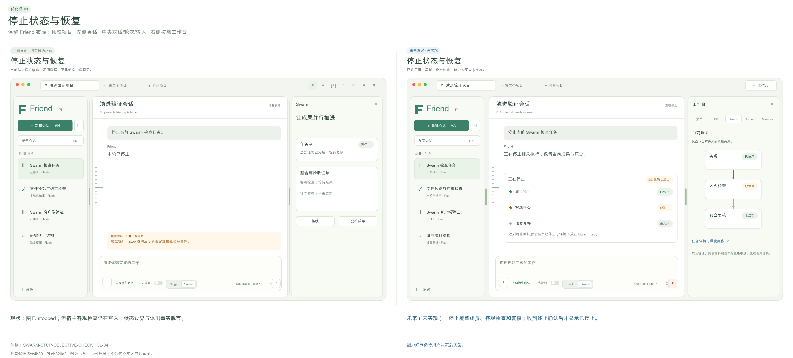

[可放大SVG](visuals/01-comparison.svg) · [优化前](visuals/01-before.svg) · [优化后](visuals/01-after.svg)

**真实截图。** [reasonix-stop-ask](screenshots/reasonix-stop-ask.jpg)。截图仅支持上文已注明的观察，不能证明全部交互组合。

**核验依据。** SWARM-STOP-OBJECTIVE-CHECK；CL-04 待复现。

**一手参考。** [MiniMax 停止级联源码](https://github.com/MiniMax-AI/minimax-code/blob/56221c121c6e63d0e50b68f57d4abf083afed119/packages/local-runtime/src/background-task/user-stop-cascade.ts) · [Reasonix 中断工具恢复](https://github.com/esengine/DeepSeek-Reasonix/blob/v1.38.6/docs/TOOL_RECOVERY.zh-CN.md)。

### 02 · 原始历史缺失保护

**P0 · 既有能力修复 · 工作量S · 依赖：无**

**优化前。** 已登记 JSONL 文件缺失时 Main 传入 undefined，SDK 建立新历史，ready 后桌面索引静默改成新路径；隔离 Main harness 已复现。此时并未证明旧文件被删除，但原会话的历史入口会丢失。

**竞品对照与证据范围。** Codex 的 worktree 恢复和环境身份值得借鉴，但本轮自应用 GUI 被阻止；这是官方资料参考，没有直接体验历史损坏恢复。

**优化方案。** 区分新建会话和恢复已有会话。恢复前验证已登记路径及会话身份；缺失/损坏时保留索引，显示明确错误和只读诊断。用户可重新定位原史、查看已有备份，或明确另建会话；禁止覆盖旧身份。

**客户端变化。** 会话卡显示历史不可用；中央恢复卡保留项目/会话/原路径，提供选择原史与另建按钮。恢复失败仍可查看诊断并返回其他会话。

**预期使用体验。** 历史异常可解释、可恢复，不把空白聊天伪装成原会话。

**实现边界。** Electron Main 的 session open 与索引；不把 SQLite 聊天副本引入系统。

**完成判据。** 自有临时会话正常退出后移动 JSONL，打开必须报缺史且索引保持；恢复原文件后全部原条目和分支身份可读。另测损坏 JSONL、路径重定向和错误身份。

**风险与限制。** 自动备份若新增，必须限定容量与可读权限；首修可以只实现 fail-closed 和手动重定位。

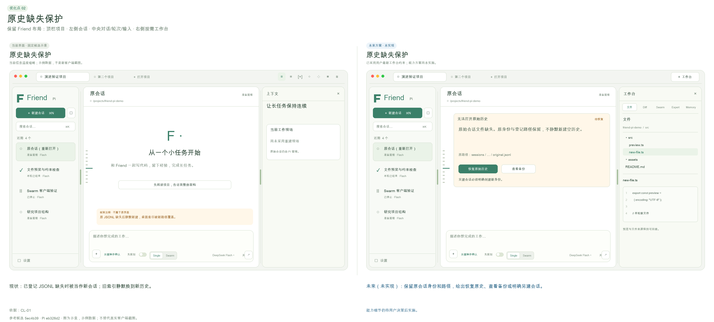

[可放大SVG](visuals/02-comparison.svg) · [优化前](visuals/02-before.svg) · [优化后](visuals/02-after.svg)

**核验依据。** CL-01。

**一手参考。** [Codex 官方 Worktree](https://learn.chatgpt.com/docs/environments/git-worktrees)。

### 03 · 完整消息、Markdown 和工具过程

**P0 · 修复与展示完善 · 工作量M · 依赖：02**

**优化前。** 冷恢复只投影 role/text/id；原生 JSONL 的 image、thinking、toolCall 仍存在，但客户端缺工具名/参数/结果关联。当前流式本轮已有工具过程，不能说完全没有。链接、表格、编号列表按原 Markdown 显示，真实 GUI 与静态渲染都观察到。

**竞品对照与证据范围。** DSH 本轮普通 Chat 实际展开命令、输入、EXIT=0 和耗时，回答表格也正确展示；Reasonix 使用过程折叠与本轮结果收据。DSH 专门 Trajectory 视图本轮未切换，不能把普通工具展开记为 Trajectory 验收。

**优化方案。** 从 Pi 原条目生成版本化展示 DTO，保留内容块、toolCallId、工具输入/输出/状态及来源。使用安全 Markdown 渲染链接、表格、编号、代码与复制，所有文件链接经过项目边界解析。历史和当前轮使用同一投影，不新增历史权威存储。

**客户端变化。** 每轮默认显示简洁结果与折叠过程；展开后可核对工具名、命令、输入、输出与取消状态。图片原附件和能力限制可见；错误成为独立卡片。

**预期使用体验。** 长对话重开后仍能验证‘读了什么、做了什么’，研发答复可直接阅读和打开来源。

**实现边界。** core history adapter、SDK事件DTO、Renderer；Pi JSONL仍唯一原史。

**完成判据。** 同一真实原史含图片/思考/两个同名不同参数工具，冷重启前后投影一致，结果准确关联；安全链接、表格、列表、长代码、失败/取消工具与恶意HTML不能误执行。

**风险与限制。** 渲染器要处理很大的工具输出，保留分页与原文入口，不能全量一次塞入DOM。

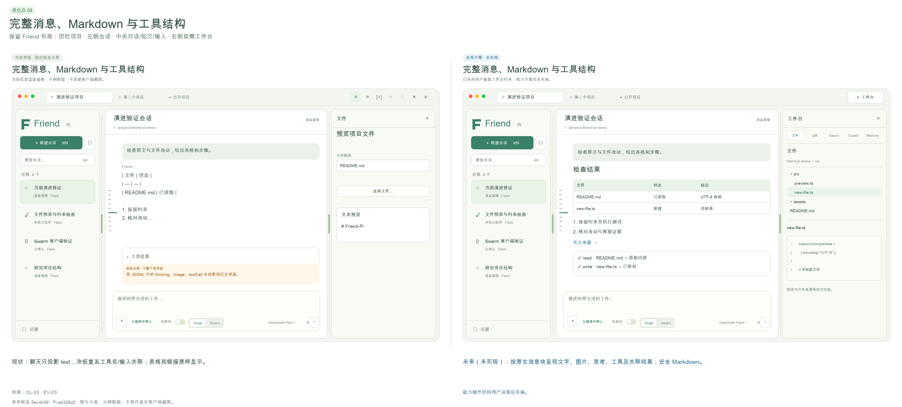

[可放大SVG](visuals/03-comparison.svg) · [优化前](visuals/03-before.svg) · [优化后](visuals/03-after.svg)

**真实截图。** [friend-single-format](screenshots/friend-single-format.jpg) · [dsh-command-output](screenshots/dsh-command-output.jpg) · [reasonix-result-and-preview](screenshots/reasonix-result-and-preview.jpg)。截图仅支持上文已注明的观察，不能证明全部交互组合。

**核验依据。** CL-03；EV-03。

**一手参考。** [DeepSeek Harness 官方仓库](https://github.com/deepseek-ai/deepseek-harness) · [Reasonix 本轮成果与检查](https://github.com/esengine/DeepSeek-Reasonix/blob/v1.38.6/docs/TURN_RESULTS.zh-CN.md)。

### 04 · 完整变更清单与未跟踪文件 Diff

**P0 · 既有能力修复 · 工作量S · 依赖：03**

**优化前。** git diff HEAD 不包含未跟踪新文件。根 Agent 在临时项目新增 new-proof.txt，文件预览能打开，但 Diff 说‘当前没有工作区改动’；真实 Git fixture 也复现。

**竞品对照与证据范围。** Codex 官方 review 说明区分 Unstaged/Staged/Branch/Last turn，未提交审查包括未跟踪文件；仅资料核对。Reasonix 真实执行收据显示2文件、部分统计与检查结果；其 Diff 点击本轮未确认转变。

**优化方案。** 用 Git status 建立完整文件清单，分别处理 tracked/untracked/deleted/renamed/binary。未跟踪文件显示内容作为新增，不偷偷 git add。第一步修漏报；再加入工作区与本轮变更两种范围和检查收据。

**客户端变化。** 右侧按文件展示新增/修改/删除及跟踪状态，选文件看差异。本轮结果卡与真实检查联动，统计不可用明确提示。

**预期使用体验。** 用户能审阅所有成果，避免以为没有改动而漏掉模型创建的新文件。

**实现边界。** 桌面Git只读服务与结果投影；不新增提交/推送/PR自动流程。

**完成判据。** 覆盖仅untracked、已暂存、未暂存、rename/delete、二进制、空文件、忽略文件与非Git项目；UI统计与真实status一致，查看不会改变索引。

**风险与限制。** 本轮差异需有真实基线，不能把全工作区用户改动都标作Agent成果。

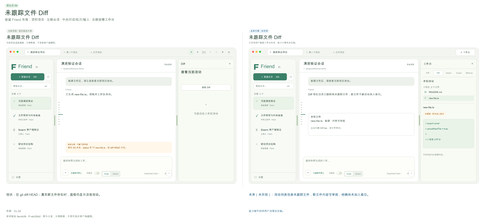

[可放大SVG](visuals/04-comparison.svg) · [优化前](visuals/04-before.svg) · [优化后](visuals/04-after.svg)

**真实截图。** [friend-diff-untracked](screenshots/friend-diff-untracked.jpg) · [friend-file-preview](screenshots/friend-file-preview.jpg) · [reasonix-plan-execution-check](screenshots/reasonix-plan-execution-check.jpg)。截图仅支持上文已注明的观察，不能证明全部交互组合。

**核验依据。** CL-02。

**一手参考。** [Codex 官方代码审阅](https://learn.chatgpt.com/docs/code-review)。

### 05 · 纠正约束与事实粒度的失效关系

**P0 · 既有能力修复 · 工作量L · 依赖：03**

**优化前。** R01：普通纠正蓝色→绿色后现场仍保留双方，根 GUI 已再次复现。R02：同一消息中的数据库与UTF-8要求共用entry，只纠正数据库后整entry退休，未改的UTF-8约束一并丢失；此项为组合回归fixture，不冒充真实GUI已复现。

**竞品对照与证据范围。** Reasonix 精确版本源码将背景事实、指令、召回和冲突作用域分层；本轮只实际查看Memory页，未对其纠正做同等故障测试。DSH计划全文明确约束及成功标准，是当前任务可读性参考。

**优化方案。** 把来源引用细化成事实/片段身份，保留原entry和被替代关系。普通明确纠正在下一安全边界处理；若无法可靠消歧，标记冲突待确认，不同时称两条为有效。Memory纠正只撤回相应事实和派生，其他约束继续有效。

**客户端变化。** 工作台取消上下文页面。普通纠正必要时在对话里给一条简短冲突确认；事实替代、来源覆盖和派生影响在设置-高级诊断按需回查。

**预期使用体验。** 改一条要求不会丢其他要求，也不会让旧要求继续以有效身份影响执行。

**实现边界。** Memory与ReBuild版本化失效事件、持久来源覆盖；不把Topic变成权限或执行控制。

**完成判据。** 蓝→绿普通纠正安全边界后只绿有效；同entry两个事实只改一个，另一个和派生仍在；整理期间新增消息不丢；保存失败不推进水位。

**风险与限制。** 语义识别不能只靠模型自评。无法确定的更正必须让用户确认，规则/来源仍能逐项核对。

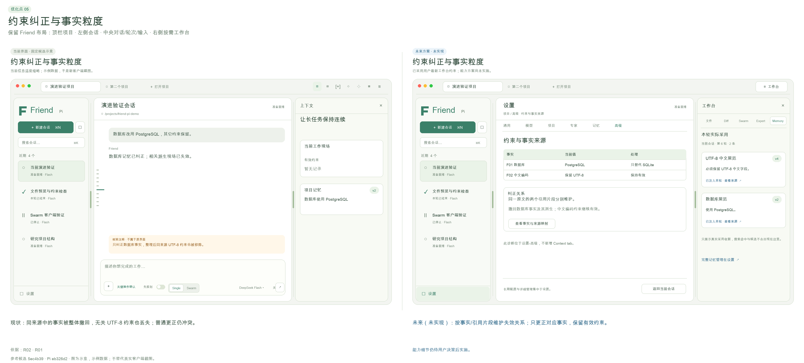

[可放大SVG](visuals/05-comparison.svg) · [优化前](visuals/05-before.svg) · [优化后](visuals/05-after.svg)

**真实截图。** [friend-context-correction](screenshots/friend-context-correction.jpg) · [friend-memory-versions](screenshots/friend-memory-versions.jpg)。截图仅支持上文已注明的观察，不能证明全部交互组合。

**核验依据。** R01；R02。

**一手参考。** [Reasonix 记忆与上下文](https://github.com/esengine/DeepSeek-Reasonix/blob/v1.38.6/docs/SESSION_MEMORY_RETRIEVAL.zh-CN.md)。

### 06 · 遗忘不复出、候选整理与中文明确记住

**P0 · 既有能力修复 · 工作量M · 依赖：05**

**优化前。** 真实Pi fork保留旧entryId/body、换新sessionId后，换词旧事实可再次成为候选；未自动active，不能说有效记忆已复活。‘请帮我记住’被规则误拒绝。Dream当前只精确去重与同标题冲突；真实GUI产生相近的数据库、UTF-8候选。

**竞品对照与证据范围。** MiniMax真实设置区分使用记忆与主动学习；Codex官方也区分use/generate，资料参考。Reasonix Memory页说明背景记忆引用前仍应验证；都不能代替本产品遗忘语义的测试。

**优化方案。** 将遗忘绑定证据谱系和事实身份，跨fork/冷启动继续抑制；保留可回查原史。扩充中文肯定表达并严格保护否定。候选按事实聚合，冲突/重复/过期标记后由用户采用；Memory无Expert时保留方法候选，并提供恢复后补投。

**客户端变化。** 工作台Memory只列本轮真实注入/采用的记忆与来源版本，候选/全库/纠正/遗忘/方法补投都在设置-记忆；所有类别有独立的生效说明。

**预期使用体验。** 减少候选噪声，用户纠正和遗忘具有持续效果，常见中文记住请求可用。

**实现边界。** Memory谱系/抑制、Dream整理与跨插件补投协议；个人偏好仍仅明确要求保存。

**完成判据。** 真实SessionManager.forkFrom及同会话冷启后换词反思不复出；短entryID碰撞不误删其他事实。‘请帮我记住’成功，‘请不要记住’与引用他人请求不保存个人偏好。

**风险与限制。** 语义重复不应简单删除：保留证据、冲突及用户撤回权；从未验证的候选不能自动成为有效方法。

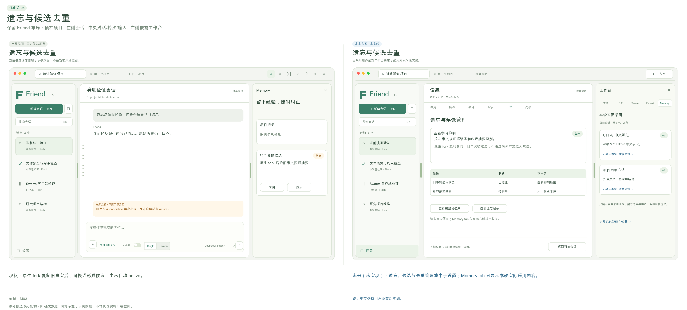

[可放大SVG](visuals/06-comparison.svg) · [优化前](visuals/06-before.svg) · [优化后](visuals/06-after.svg)

**真实截图。** [friend-memory-baseline](screenshots/friend-memory-baseline.jpg) · [minimax-memory-manager](screenshots/minimax-memory-manager.jpg) · [reasonix-memory-loaded](screenshots/reasonix-memory-loaded.jpg)。截图仅支持上文已注明的观察，不能证明全部交互组合。

**核验依据。** M01；M03；Dream部分实现。

**一手参考。** [MiniMax 官方 Memory](https://agent.minimax.io/docs/code/agents/memory) · [Codex 官方 Memory](https://learn.chatgpt.com/docs/customization/memories)。

### 07 · 应用级前台优先与后台工作中心

**P0 · 修复与管理完善 · 工作量M · 依赖：01**

**优化前。** 后台控制器彼此串行，但B会话开始前台请求只取消B实例，A后台provider仍继续。GUI只展示最近6项jobs，阶段与暂停入口已有。没有背景额度上限是已接受的产品选择，不应借竞品额外加入硬上限。

**竞品对照与证据范围。** Reasonix源码有跨会话任务监控，Codex官方支持长任务/后台worktree；本轮并未同等测试其前台抢占。这是可观察任务中心的参考，不是性能优越结论。

**优化方案。** 以应用级前台租约协调所有会话后台调用，前台启动使背景停到安全边界。串行后台调度显示来源、阶段、原因、重试次数和停止线；暂停状态持久化，恢复必须显式。

**客户端变化。** 设置-后台工作展示全局/项目队列与暂停、重试。工作台不放学习管理表单；对话仅在背景让路或有待处理错误时给精简状态。

**预期使用体验。** 交互请求优先，后台运行不再成为看不见的延迟来源。

**实现边界。** core宿主与Memory/Expert跨进程版本协议、队列租约；不依赖共享库单例。

**完成判据。** 两活会话/不同进程中A背景调用、B前台启动，A signal在规定时间内中止或完成安全边界；晚结果不发布；后台最多3次失败后停；暂停/恢复冷启一致。

**风险与限制。** provider可能不能真正停止远端计费，界面应显示本地取消收据和远端状态未知，不能承诺取消即零成本。

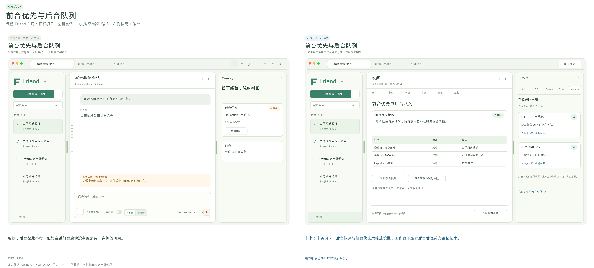

[可放大SVG](visuals/07-comparison.svg) · [优化前](visuals/07-before.svg) · [优化后](visuals/07-after.svg)

**真实截图。** [friend-memory-baseline](screenshots/friend-memory-baseline.jpg)。截图仅支持上文已注明的观察，不能证明全部交互组合。

**核验依据。** M02。

**一手参考。** [Reasonix 任务监控源码](https://github.com/esengine/DeepSeek-Reasonix/blob/e2145b031deef603d9ec1acc9d30f9a1e1ac9325/desktop/frontend/src/components/TaskMonitorPanel.tsx) · [Codex 官方 Worktree](https://learn.chatgpt.com/docs/environments/git-worktrees)。

### 08 · 专家采用策略一致与本轮版本透明

**P0 · 既有能力修复 · 工作量M · 依赖：03**

**优化前。** 自动use只读专家后bash未受同样范围限制，明确指定同专家会拦截；版本冻结和采用记录已存在。GUI有专家选择和版本管理，但不显示当前轮真实采用版本/hash。

**竞品对照与证据范围。** Reasonix实际子智能体页显示固定工具数量、模型/推理继承来源；ZCode实际页区分内置general-purpose与只读Explore。Profile和模型身份分开，但它们没有证明具备Friend-Pi的客观成长门槛。

**优化方案。** 统一自动与明确采用的策略计算，在采用时校验冻结范围，不扩大本轮权限。公开采用收据，展示id/version/hash/Skill及工具范围；后续编辑明确下次执行生效。Swarm成员绑定自己实际采用的专家版本。

**客户端变化。** 统一工作台的Expert页仅展示本轮所选/实际采用专家的介绍、专业方向、常用Skill与采用版本。选择策略、启停、编辑、历史和权限细节放设置。

**预期使用体验。** 用户知道模型和方法各是什么，以及实际用了哪版，行为不因自动/手选而矛盾。

**实现边界。** Expert beginRun/use策略、Swarm成员上下文与采用收据；沿用Pi工具钩子，不称完整OS沙箱。

**完成判据。** read-only专家自动与明确两场景bash都拦；执行中编辑不改变当前快照；下一轮v2生效；成员和主会话各有真实采用记录，历史v1不改。

**风险与限制。** 多个专家范围组合须有明确交集/覆盖规则；不能为了专家名好看而增加权限。

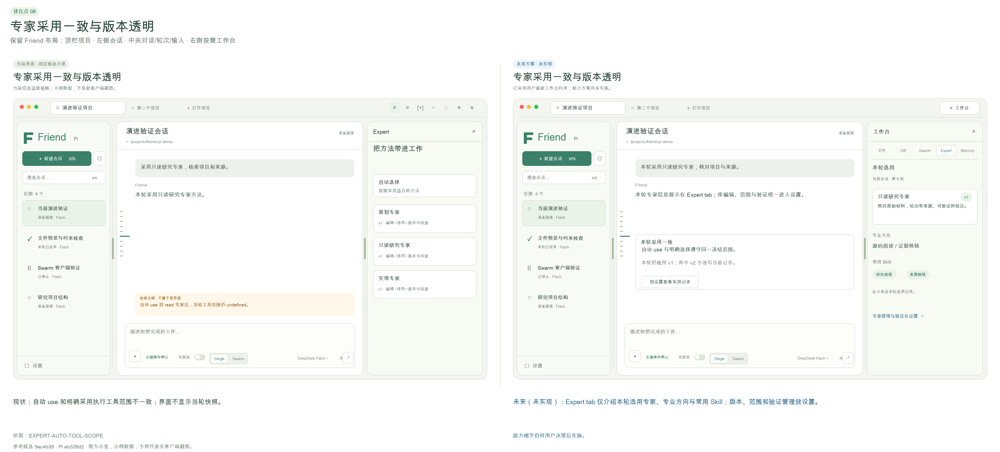

[可放大SVG](visuals/08-comparison.svg) · [优化前](visuals/08-before.svg) · [优化后](visuals/08-after.svg)

**真实截图。** [friend-expert-diff](screenshots/friend-expert-diff.jpg) · [reasonix-subagents](screenshots/reasonix-subagents.jpg) · [zcode-subagents](screenshots/zcode-subagents.jpg)。截图仅支持上文已注明的观察，不能证明全部交互组合。

**核验依据。** EXPERT-AUTO-TOOL-SCOPE。

**一手参考。** [Reasonix 子智能体档案](https://github.com/esengine/DeepSeek-Reasonix/blob/v1.38.6/docs/SUBAGENT_PROFILES.zh-CN.md)。

### 09 · DAG、定向返工与可操作的成员现场

**P1 · 先补原承诺，再增强可视化 · 工作量L · 依赖：01, 04, 08**

**优化前。** 依赖卡片、并发、任务尝试、结果、消息与独立复核真实存在；两任务只拒绝a时a和b都重跑。成员工具过程/原会话/保留worktree只以JSON路径呈现。根GUI自动拆分曾被非法写入范围拒绝，草稿保留但错误是底层RPC文字；手动两只读任务成功整合。

**竞品对照与证据范围。** DSH本轮实际两个只读子智能体完成、父会话汇总，谱系菜单可打开成员原会话；只证明该夹具只读协作，没有验证写入并发/合并/异常。MiniMax Agent Team官方说明分工与复核，本轮桌面执行未确认。Reasonix TaskMonitor为源码与入口参考。

**优化方案。** 先增加受影响任务集合与依赖闭包，复核指向任务/检查，保留其他已通过成果。提供图视图与列表视图，成员可查看原过程和工作区。自动拆分先产生可修订草案，结构无效时给出字段问题和最多有限修复，不直接启动。返工前用户可改方法/范围，仍有2轮停止线。

**客户端变化。** 统一工作台Swarm页主要展示当前规划的DAG和节点状态、依赖关系；不常驻新建任务、成员聊天、共享表单和验证长卡。返工、方法调整与过程诊断放设置中的任务详情，成果可跳文件/Diff。

**预期使用体验。** 多人工作可理解、可干预，避免无关重跑和只看一个最终回答。

**实现边界。** Swarm调度与契约、客户端图/成员视图；成员不递归派生，Git隔离与非Git串行保留。

**完成判据。** 复核只拒a且b独立时仅a重跑；a下游闭包准确失效；相同文件冲突保留worktree、基线变化暂停；原任务不会被改写，调整形成新尝试。无效自动图不启动成员。

**风险与限制。** 图不能成为执行权威；控制器校验每次操作版本。非Git写入仍串行且不承诺自动回滚。

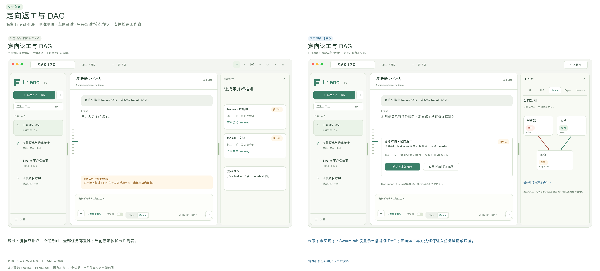

[可放大SVG](visuals/09-comparison.svg) · [优化前](visuals/09-before.svg) · [优化后](visuals/09-after.svg)

**真实截图。** [friend-swarm-running](screenshots/friend-swarm-running.jpg) · [friend-swarm-completed](screenshots/friend-swarm-completed.jpg) · [dsh-subagent-lineage](screenshots/dsh-subagent-lineage.jpg) · [dsh-subagent-original](screenshots/dsh-subagent-original.jpg)。截图仅支持上文已注明的观察，不能证明全部交互组合。

**核验依据。** SWARM-TARGETED-REWORK；Swarm真实GUI。

**一手参考。** [MiniMax 官方 Agent Team](https://agent.minimax.io/docs/code/agents/team) · [DeepSeek Harness 官方仓库](https://github.com/deepseek-ai/deepseek-harness)。

### 10 · 共享材料提交顺序与冲突合并

**P1 · 既有能力修复与体验完善 · 工作量S · 依赖：无**

**优化前。** 版本CAS、短锁、不可变文件已通过；shared.changed先于事务commit，订阅者另一连接读不到通知所称版本。GUI保存v1已实际成功，但冲突后只提示刷新重载草稿。

**竞品对照与证据范围。** Codex官方审阅允许定位到文件/行并提交反馈，作为冲突差异的资料参考；这不是共享文件锁机制的对等实测。

**优化方案。** 提交成功后再发布事件，每事件带图/文档/版本身份。冲突界面同时展示基于版本、最新版本与本地草稿，用户明确合并后CAS写入，不在模型思考期间占锁。

**客户端变化。** Swarm页保持依赖图。共享材料作为只读材料可从文件页打开；编辑/CAS冲突与消息收据在设置-任务详情按需查看，不另加顶栏按钮。

**预期使用体验。** 协作意见不会静默覆盖，用户能理解冲突和通知代表的真实状态。

**实现边界。** Swarm事务事件与共享文件协议、客户端差异；不引入复杂实时协作文档框架。

**完成判据。** 事件观察后第二SQLite连接能读到同版本；双写竞争一个成功一个明确CAS冲突，草稿保留；取消合并不写入。重复消息不重复处理。

**风险与限制。** 长期持锁会阻塞模型；仅在原子写边界占锁，GUI合并阶段不占锁。

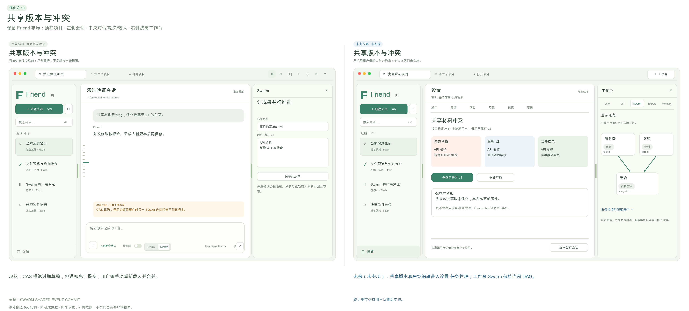

[可放大SVG](visuals/10-comparison.svg) · [优化前](visuals/10-before.svg) · [优化后](visuals/10-after.svg)

**真实截图。** [friend-swarm-completed](screenshots/friend-swarm-completed.jpg)。截图仅支持上文已注明的观察，不能证明全部交互组合。

**核验依据。** SWARM-SHARED-EVENT-COMMIT。

**一手参考。** [Codex 官方代码审阅](https://learn.chatgpt.com/docs/code-review)。

### 11 · Plan 审批卡与执行转换

**P1 · 既有探索补齐与交互增强 · 工作量M · 依赖：03, 08**

**优化前。** 计划模式已在工具边界禁写，不是仅提示词；默认工具仅read/bash/edit/write且计划禁bash，陌生目录缺ls/find/grep探索。用户切开关后能发只读请求，但没有独立的计划全文审批及采用身份。

**竞品对照与证据范围。** DSH本轮实际Plan→右侧全文→同意执行，Reasonix实际三步方案→开始/修改/暂不执行→两文件改动+两测试通过；均在隔离临时项目。

**优化方案。** 优先补原生只读目录/搜索工具。计划形成版本化文档，展示范围、假设、成果和客观检查；用户批准该版本后转执行，可要求修改或退出。计划模式与Single/Swarm正交，不新增第三种Team模式。

**客户端变化。** 保留composer先规划滑块；中央短审批卡提供开始/修改/退出，计划全文在统一工作台文件页作为只读文档打开。批准时简短显示执行方式和模型/专家快照。

**预期使用体验。** 用户能批准具体方案，避免只是开关名字叫计划，实际执行内容仍不清楚。

**实现边界。** SDK原生工具配置、应用计划控制器/审批桥；Pi公开扩展接口可实现，不改loop。

**完成判据。** 陌生嵌套项目能只读列举/搜索，写工具仍阻断；修改计划后旧批准失效；取消/超时/会话切换不批准；批准对应planId/version后才执行。

**风险与限制。** 批准计划不是无限授权，关键破坏性操作仍单独确认。

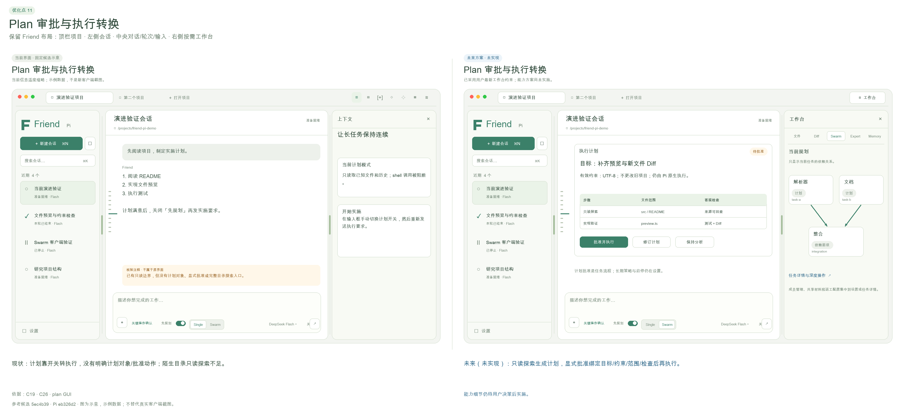

[可放大SVG](visuals/11-comparison.svg) · [优化前](visuals/11-before.svg) · [优化后](visuals/11-after.svg)

**真实截图。** [reasonix-plan-ready](screenshots/reasonix-plan-ready.jpg) · [dsh-plan-ready](screenshots/dsh-plan-ready.jpg) · [reasonix-plan-execution-check](screenshots/reasonix-plan-execution-check.jpg)。截图仅支持上文已注明的观察，不能证明全部交互组合。

**核验依据。** C19部分实现；真实竞品Plan旅程。

**一手参考。** [Reasonix 使用指南](https://github.com/esengine/DeepSeek-Reasonix/blob/v1.38.6/docs/GUIDE.zh-CN.md) · [DeepSeek Harness 官方仓库](https://github.com/deepseek-ai/deepseek-harness)。

### 12 · 项目与会话组织、状态和待处理入口

**P1 · 客户端管理增强 · 工作量M · 依赖：01, 02**

**优化前。** 横向项目栏、左侧会话卡状态、新建、重命名、名称搜索和历史已有。执行/等待/暂停/失败/停止状态部分齐备；首版无归档、关闭项目、跨会话待处理中心，这些不全是原承诺缺陷。

**竞品对照与证据范围。** MiniMax实际项目分组和pin/archive入口、Reasonix实际项目树/时间筛选、ZCode实际分组/项目切换与归档入口；本轮未执行所有归档恢复流程。Codex组织为资料参考。

**优化方案。** 保持Friend横项目+左会话主布局，增加待审批/正在停止/需接续状态和可点击原因。提供置顶、可恢复归档和按状态筛选；搜索明确区分名称/原史正文，正文走Pi可重建索引。关闭项目只关闭界面，不删除数据。

**客户端变化。** 左侧近期/置顶/归档与状态筛选，卡片简短显示标题/模型/状态。右上只保留工作台入口；等待用户决定的事项在中央提示或会话卡状态呈现。

**预期使用体验。** 项目多、会话长时仍能找到当前任务与等待自己决定的事项。

**实现边界。** 客户端导航与可重建索引，历史仍Pi权威；原Friend数据迁移继续排除。

**完成判据。** 两项目多会话的草稿/附件/模型/plan不串；归档可恢复；名称与正文搜索语义清楚；后台状态不会把完成的工具当完成任务。

**风险与限制。** 不能复制竞品一长串导航挤占会话；默认只显示开发主流程。

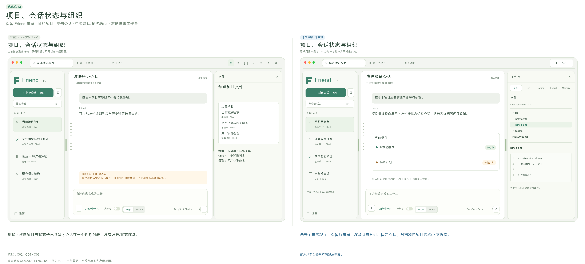

[可放大SVG](visuals/12-comparison.svg) · [优化前](visuals/12-before.svg) · [优化后](visuals/12-after.svg)

**真实截图。** [friend-sidebar-resized](screenshots/friend-sidebar-resized.jpg) · [minimax-new-task](screenshots/minimax-new-task.jpg) · [zcode-home](screenshots/zcode-home.jpg)。截图仅支持上文已注明的观察，不能证明全部交互组合。

**核验依据。** 现有布局已实现；C58演进范围。

**一手参考。** [MiniMax 官方任务与历史](https://agent.minimax.io/docs/code/workflows/tasks) · [Codex 官方项目与会话](https://learn.chatgpt.com/docs/projects)。

### 13 · Codex 风格轮次预览的检索与书签增强

**P2 · 已实现能力上的增强 · 工作量S · 依赖：03, 12**

**优化前。** 当前已有左侧短线标记、定位、用户+助手预览、书签及冷恢复。根GUI点击第2轮确实出现预览和收藏按钮。不能把这一点写成尚未实现。

**竞品对照与证据范围。** 用户提供的Codex局部截图是明确视觉要求：短线侧轨+浮卡+书签。本轮Codex自应用被CUA限制，未真实点悬停；Reasonix实际问题导航slider是另一个可访问形态。

**优化方案。** 保留现有侧轨和浮卡风格，增加关键词、仅书签和Topic相关轮次筛选，以及键盘范围跳转。显示用户原问题、结果短摘要、执行/取消状态和来源入口。Topic只参与选材，用户不用维护标签。

**客户端变化。** 保留侧轨浮卡和书签，必要时展开关键词筛选；原文/前后文作为只读材料在统一工作台文件页打开，取消独立上下文页。

**预期使用体验。** 既保持轻巧导航，又能从数十轮中找回决定，不靠滚动猜位置。

**实现边界。** 纯客户端+ReBuild查询；索引可重建，不保存另一份聊天权威。

**完成判据。** 50+轮定位、键盘、长中文、多工具中断、仅书签和搜索无命中；重启后书签不串会话，原entry丢失显示明确状态。

**风险与限制。** 浮卡不得挡住composer；窄屏采用弹层而非挤占主体。

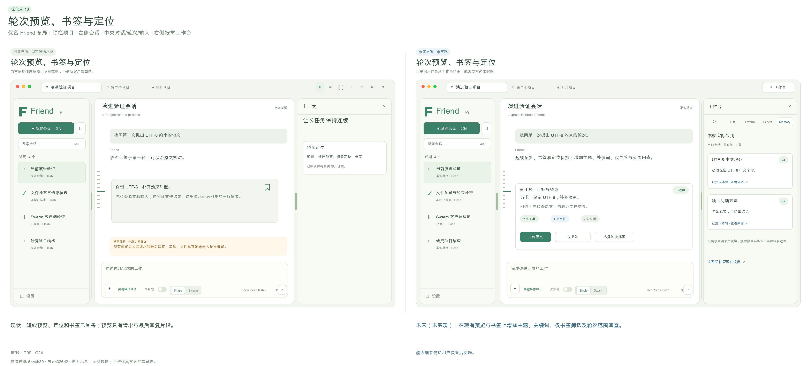

[可放大SVG](visuals/13-comparison.svg) · [优化前](visuals/13-before.svg) · [优化后](visuals/13-after.svg)

**真实截图。** [friend-turn-preview](screenshots/friend-turn-preview.jpg)。截图仅支持上文已注明的观察，不能证明全部交互组合。

**核验依据。** 真实GUI轮次预览；用户Codex截图。

[用户给定Codex轮次预览原图](reference-images/codex-turn-preview.png)

### 14 · 分栏比例、窄屏与键盘操作

**P2 · 已实现布局的质量增强 · 工作量S · 依赖：12**

**优化前。** 左右可拖分栏、键盘调宽、冷恢复与窄屏左栏自动隐藏已实现。根GUI侧栏319→251拖动成功，720×610窗口检查后恢复。比例不能写成缺失功能；主要问题是多面板/长表单在小窗口的使用质量还需更多覆盖。

**竞品对照与证据范围。** Reasonix实际可调输入区高度与工作区分栏，MiniMax快捷键页详细列面板导航，ZCode外观页能预览代码主题。夜间模式仅为竞品当下设置，方案继续浅色。

**优化方案。** 为阅读、对话、协作提供少量可保存的布局预设；每项目恢复比例，双击分隔条恢复默认。窄屏右工作台改抽屉/全屏，关键模式控制始终可操作。补齐统一快捷键说明和焦点返回。

**客户端变化。** 右上只有工作台入口，内部文件/Diff/Swarm/Expert/Memory五页。布局预设、字体、密度和快捷键放设置；窄屏工作台抽屉或全屏，单页内容保持简洁。

**预期使用体验。** 用户能根据任务分配空间，大量按钮不会在窄窗口挤成难操作的一行。

**实现边界。** 纯客户端布局持久化与无障碍；不加入浮动多窗口。

**完成判据。** 宽1320×860、窄720×610及系统缩放；鼠标拖/方向键/双击/重启恢复，Tab焦点顺序、Esc关闭抽屉、视觉控件可见。

**风险与限制。** 预设不能改变模型、插件或执行状态，只调整布局。

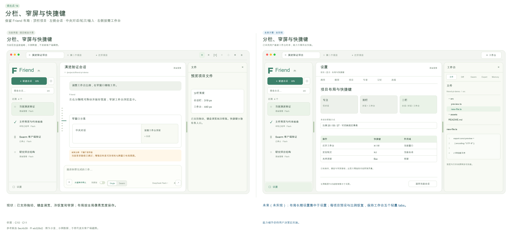

[可放大SVG](visuals/14-comparison.svg) · [优化前](visuals/14-before.svg) · [优化后](visuals/14-after.svg)

**真实截图。** [friend-sidebar-resized](screenshots/friend-sidebar-resized.jpg) · [friend-narrow-window](screenshots/friend-narrow-window.jpg) · [minimax-shortcuts](screenshots/minimax-shortcuts.jpg)。截图仅支持上文已注明的观察，不能证明全部交互组合。

**核验依据。** 本轮真实GUI拖动与窄屏。

**一手参考。** [MiniMax 官方快捷键](https://agent.minimax.io/docs/code/desktop/shortcuts) · [MiniMax 官方外观](https://agent.minimax.io/docs/code/desktop/appearance)。

### 15 · 文件、附件与多标签材料工作台

**P1 · 客户端主流程增强 · 工作量M · 依赖：03, 04**

**优化前。** 已有相对路径文本预览、选择文件、文本/图片附件；真实new-proof文本预览成功。无文件树和多标签。图片预览代码分支被文本读取边界阻断属于增强，旧文档只承诺文本预览；历史图片丢结构则属于03修复。

**竞品对照与证据范围。** Reasonix本轮实际文件树→README预览。DSH实际计划在右侧全文tab，普通文件链接点击未确认打开预览，不算通过；官方源码支持多类材料。MiniMaxFiles/Changes/Terminal仅资料与入口参考。

**优化方案。** 右工作台增加可过滤文件树和材料tabs，回答的项目路径一键定位；支持文本/Markdown/图片安全预览，代码行/片段可加到composer。附件发送前显示大小、截断、文本/视觉能力及相同文件去重。

**客户端变化。** 统一工作台五页内切换，文件页支持文件树与少量文档tab，计划和来源作为文件材料打开；Diff参考Codex按文件折叠/行号/增删色展示，避免把所有管理功能做成新的tab。

**预期使用体验。** 阅读、提问、修改和审阅形成短路径，同时保持中央对话空间。

**实现边界。** 桌面文件读取白名单+Renderer材料tabs；浏览器、交互终端仍不默认加入首版演进包。

**完成判据。** 路径越界/symlink越界、NUL/二进制、大文件、无视觉模型、重复附件、取消上传/读取和冷启动；tab关闭不丢其他草稿，引用含准确来源。

**风险与限制。** 预览HTML可能执行不受信脚本，应先只读展示/隔离，不能因为竞品可预览就直接执行项目内容。 材料主流程可先交付，不被14的布局预设增强阻塞。

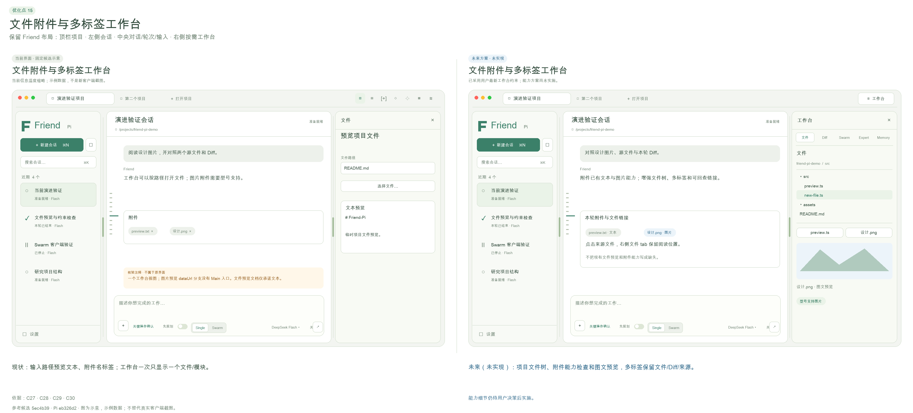

[可放大SVG](visuals/15-comparison.svg) · [优化前](visuals/15-before.svg) · [优化后](visuals/15-after.svg)

**真实截图。** [friend-file-preview](screenshots/friend-file-preview.jpg) · [reasonix-result-and-preview](screenshots/reasonix-result-and-preview.jpg) · [dsh-plan-ready](screenshots/dsh-plan-ready.jpg)。截图仅支持上文已注明的观察，不能证明全部交互组合。

**核验依据。** 真实文本预览；C31演进范围。

**一手参考。** [MiniMax 官方开发面板](https://agent.minimax.io/docs/code/desktop/panels) · [DeepSeek Harness 官方仓库](https://github.com/deepseek-ai/deepseek-harness)。

### 16 · 设置搜索、作用域与配置一致性

**P1 · 先修配置矛盾，再整合设置 · 工作量M · 依赖：08, 12**

**优化前。** 供应商与新会话默认已经放设置，长期学习/验证策略和基准仍在会话工作台。默认Swarm可与默认关闭Swarm插件同时保存，新会话静默Single。自定义Provider目前单模型且固定text/non-reasoning，能力配置不完整。

**竞品对照与证据范围。** MiniMax真实设置有搜索和任务侧栏保持；Reasonix整页设置分模型偏好/服务/权限/诊断，并显示继承来源；DSH实查模型提供商与Agentpreset、General繁忙输入行为；ZCode实查用户作用域和管理分组。

**优化方案。** 立即校验模式与插件依赖，矛盾配置保存前明确解决。设置分全局/项目，含模型服务、能力、默认执行、学习/验证、插件和界面；搜索直接定位字段。显示当前轮冻结值与下次新建值，模型测试/保存/真实任务派发各给单独结果。

**客户端变化。** 设置负责全部插件启停、专家库、记忆库、学习/验证策略、模型与长期配置。工作台只读当前任务/本轮采用内容，没有插件开关；当前执行冻结值和下一安全边界生效值分别说明。

**预期使用体验。** 配置找得到、知道作用范围，也不会保存了Swarm却实际变Single。

**实现边界。** 应用设置schema与Pi模型目录/公开配置接口；独立数据目录与凭证权限不变。

**完成判据。** 配置依赖/无效JSON/断网测试/模型不支持effort明确错误；当前执行快照不变化，下次安全reload重绑交互；不打印Key、不修改现有Pi配置。

**风险与限制。** 诊断导出必须主动去密；不能把‘已保存模型’写成‘真实调用已通过’。

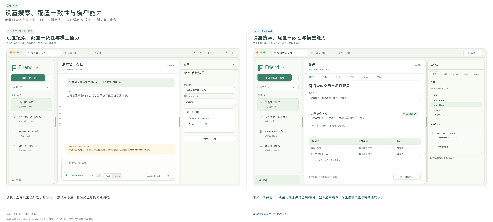

[可放大SVG](visuals/16-comparison.svg) · [优化前](visuals/16-before.svg) · [优化后](visuals/16-after.svg)

**真实截图。** [minimax-settings](screenshots/minimax-settings.jpg) · [reasonix-settings-loaded](screenshots/reasonix-settings-loaded.jpg) · [dsh-models](screenshots/dsh-models.jpg) · [zcode-settings](screenshots/zcode-settings.jpg)。截图仅支持上文已注明的观察，不能证明全部交互组合。

**核验依据。** CL-05；C55部分实现。

**一手参考。** [MiniMax 官方自定义模型](https://agent.minimax.io/docs/code/account/byok) · [Reasonix 模型设置](https://github.com/esengine/DeepSeek-Reasonix/blob/v1.38.6/docs/MODEL_SETTINGS.zh-CN.md)。

### 17 · 专家验证模板与受限成长管理

**P1 · 验证主流程完善 · 工作量L · 依赖：06, 08, 16**

**优化前。** 2正例+1反例和JSON oracle门槛已实现，候选验证/撤回/后台暂停有入口；当前范围/标准主要是提示文字，编辑suite表单未载已有基准。根GUI新建/编辑/版本差异/回滚v3/停用已实际成功，客观用例表单查看过，本轮未跑新专家自动发布旅程。

**竞品对照与证据范围。** Reasonix与ZCode Profile界面强调工具/模型继承，但本轮没发现可证明相同‘验证后成长’机制。MiniMax公开Goal verifier随模型路线不同，不能把Worker完成提案当独立复核。这里是Friend-Pi自身应做稳的差异点。

**优化方案。** 将适用范围、步骤、检查标准和验证集分别维护；已有suite可读改。为代码/研究/整合提供客观检查模板，明确何种证据足以发布及哪些候选缺条件。允许暂停、撤回、范围缩小和回滚；自动成长只发文本方法，脚本/工具权限由用户单独管理。

**客户端变化。** 专家验证套件、候选、发布/撤回、版本编辑全部放设置-专家。工作台Expert只展示本轮专家简介、方向、常用Skill和必要版本标记，不展示验证大表。

**预期使用体验。** 用户能审查专家成长的依据，避免提示词越长就被当作越来越聪明。

**实现边界。** Expert验证器可扩展，但使用Pi会话与用户提供oracle；发布不增加工具权限。

**完成判据。** 基准载入修改不丢旧案例；案例ID/输入独立性、范围外反例、来源撤回与晚到结果都校验；缺客观条件不发布；方法权限保持原范围。

**风险与限制。** Exact JSON是可复现门槛但不足以覆盖真实代码质量；增加检查类型要先保证可解释性，不引入自动执行候选脚本。

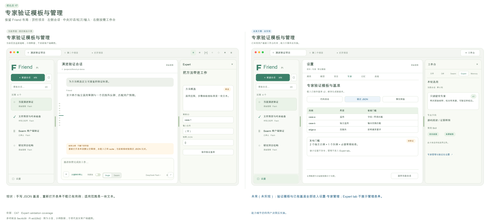

[可放大SVG](visuals/17-comparison.svg) · [优化前](visuals/17-before.svg) · [优化后](visuals/17-after.svg)

**真实截图。** [friend-expert-validation-form](screenshots/friend-expert-validation-form.jpg) · [friend-expert-diff](screenshots/friend-expert-diff.jpg) · [reasonix-subagents](screenshots/reasonix-subagents.jpg)。截图仅支持上文已注明的观察，不能证明全部交互组合。

**核验依据。** Expert专项；C47部分实现。

**一手参考。** [MiniMax 复核策略源码](https://github.com/MiniMax-AI/minimax-code/blob/56221c121c6e63d0e50b68f57d4abf083afed119/packages/agent-modules/goal/src/verification/verification-policy.ts)。

### 18 · 后台上下文连续性与按需来源回查

**P1 · 已有ReBuild上的可验证体验完善 · 工作量M · 依赖：03, 05, 06, 13**

**优化前。** 现场、来源按钮、原史搜索/原文/前后文已实现并真实可用；小会话整理回退Nothing to compact，旧同候选真实模型证明两次采用。当前来源导航缺会话名、片段位置及返回路径；本轮未重复大窗口/多主题真实模型所有组合，不能称无限上下文已验证。

**竞品对照与证据范围。** DSH上下文已用百分比与计划来源全文实际可见，Reasonix会话摘要/Context Center为界面与源码线索；Codex官方memory后台整理是资料参考，不能等同ReBuild语义正确性。

**优化方案。** 上下文后台维持目标、约束、决定、现场和版本化来源覆盖，不再提供工作台上下文tab。原文/前后文从消息、记忆来源入口打开为文件材料；手动整理和operationId、水位/回退诊断放设置的高级项。失效处理仍可靠，不回放工具。

**客户端变化。** 会话工作台不展示上下文预算或现场长卡。用户需要原文时从实际采用Memory或消息来源点开，在文件页阅读并能返回；高级诊断只在设置按需打开。

**预期使用体验。** 用户可以检查长任务承接的事实依据，知道哪些内容仍是近期原文、哪些已整理采用。

**实现边界。** ReBuild公共上下文/压缩接口与History查询、客户端导航；不替换Pi loop、不新增向量数据库。

**完成判据。** 多主题往返、早期约束、整理中输入、重复摘要、取消、来源缺失、保存失败和冷启；采用成功才推进水位，新增消息仍原文可读，回退不重放工具。

**风险与限制。** 后台上下文预算是估计而非保证，仅设置高级诊断按需显示。不能以状态面板或模型自述声称无限上下文。

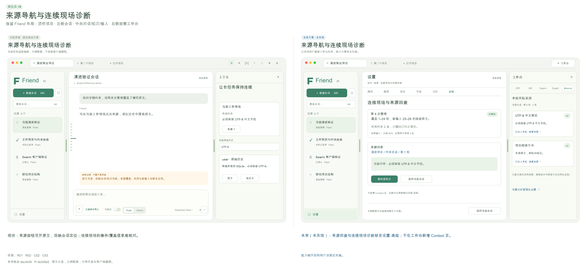

[可放大SVG](visuals/18-comparison.svg) · [优化前](visuals/18-before.svg) · [优化后](visuals/18-after.svg)

**真实截图。** [friend-history-around](screenshots/friend-history-around.jpg) · [friend-context-correction](screenshots/friend-context-correction.jpg) · [dsh-plan-ready](screenshots/dsh-plan-ready.jpg)。截图仅支持上文已注明的观察，不能证明全部交互组合。

**核验依据。** ReBuild专项；真实来源回查。

**一手参考。** [Reasonix 记忆与上下文](https://github.com/esengine/DeepSeek-Reasonix/blob/v1.38.6/docs/SESSION_MEMORY_RETRIEVAL.zh-CN.md) · [DeepSeek Harness 官方仓库](https://github.com/deepseek-ai/deepseek-harness)。

### 19 · 统一轻量工作台与真实采用收据

**P1 · 用户已确定的交互方向，尚未实施 · 工作量M · 依赖：03, 08, 12, 16**

**优化前。** 当前右上六模块入口复用同一侧面板，但页面含整库与大量管理表单。源码确认Memory无per-run注入收据，ReBuild临时拼接记忆但memoryRefs为空；Expert有Pi JSONL run/adoption和版本hash，却未被GUI消费，且其runId与桌面runId未统一。因此库列表不能冒充本轮实际使用。

**竞品对照与证据范围。** 用户最新截图与明确指令确定统一工作台及五个轻页面。文件/Diff参考Codex官方审阅的按文件折叠、行号、范围与逐行反馈形态；Codex桌面本轮CUA仍受限，因此是用户图与官方资料研究。Reasonix真实文件树/材料预览提供可用对照。

**优化方案。** 右上单一工作台按钮控制开合，内部文件、Diff、Swarm、Expert、Memory五页。Swarm显示当前规划依赖；Expert显示实际选用/采用专家介绍、方向、常用Skill；Memory显示本轮实际送入模型的记忆及工具回读来源。启停、全库、编辑、验证和诊断统一移设置，Context不设工作台页面。采用收据绑定runId和Pi原entry，记录id/revision/hash/来源与注入/检索/采用状态；不能以搜索命中或模型自称替代真实采用。

**客户端变化。** 一个入口、五个内页、每页少量当前工作信息。确认当前请求未提供记忆时显示未提供；旧轮缺收据时显示未记录，不能改写成没有使用。Expert同样区分未选、目录可用与实际采用。必要版本/来源可展开，详细管理去设置。

**预期使用体验。** 工作台成为当前任务的辅助视图，用户不被管理表单淹没；看到的专家与记忆能够解释当前执行。

**实现边界。** 客户端信息架构与Memory/Expert实际注入或工具回读的版本化收据。保持Pi JSONL唯一原史，SQLite可重建使用索引；不推断模型内部因果使用。 记忆纠正立即更新有效版本，下一安全模型请求边界不再注入失效内容；已经派发的使用收据保留原版本，不改写历史。专家按既有运行快照冻结。

**完成判据。** 同会话三轮分别注入不同记忆，Memory页只显示选定轮实际收据及准确版本；仅检索但未纳入的内容不冒充采用。停用/纠正后旧轮收据不改写，新轮正确生效；真实Expert采用一致。五tab键盘/窄屏/冷启可用；无Contexttab和面板插件开关。 同一逻辑执行的后续请求遇到纠正/遗忘，下一安全边界使用新有效版本或排除失效项，不能为了收据稳定而继续注入旧错误。

**风险与限制。** “已送入上下文”可证明，不等于“模型一定依据它做了决定”。文案必须明确该边界；没有收据时显示未记录，不能补造历史采用事实。

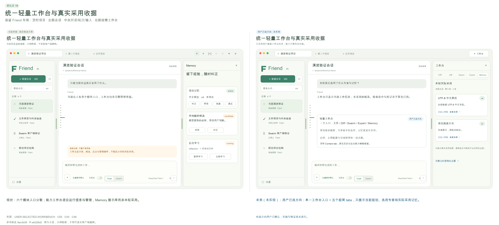

[可放大SVG](visuals/19-comparison.svg) · [优化前](visuals/19-before.svg) · [优化后](visuals/19-after.svg)

**真实截图。** [friend-context-correction](screenshots/friend-context-correction.jpg) · [friend-memory-baseline](screenshots/friend-memory-baseline.jpg) · [friend-expert-baseline](screenshots/friend-expert-baseline.jpg)。截图仅支持上文已注明的观察，不能证明全部交互组合。

**核验依据。** 用户最新统一工作台要求；Memory/Expert采用边界源码核查；SOURCE-USAGE-MISSING：源码核对，新要求边界，不计入13项旧缺陷。

[当前Memory/Expert采用证据与最小接口建议](evidence/research/codex-dsh/friend-pi-usage-receipt-boundary.md)

[用户明确指定统一工作台的原图](reference-images/user-unified-workbench.png)

**一手参考。** [Codex 官方代码审阅](https://learn.chatgpt.com/docs/code-review)。

## 验收与后续施工方式

每批要形成可复现闭包：需求回归→控制器/SDK测试→同候选实际GUI→真实模型小旅程→冷重启/取消→制品与来源记录。先保留当前失败用例，不允许改变断言掩盖缺口。写并发仍用独立worktree，整合串行；GUI保持单一调度。新接口先冻结再并行，每个子Agent明确目录与共享写边界。

本地报告不创建远端、发npm、签名发行或宣布Acceptance。你选择后再实施；涉及持久数据迁移时另给备份/回退的可审核方案。新候选最终记录代码commit、Pi SHA、app/ZIP摘要及绝对路径；重新跑同候选Computer Use，而不是用本次研究截图冒充新候选验收。

## 开源参考与引用记录

本轮只研究和生成原创示意图，没有复制竞品实现源码。Pi保留原固定SHA。MiniMax公开源主要MIT、部分vendored Apache-2.0；Reasonix标签MIT；DSH MIT；Codex Apache-2.0；ZCode Apache-2.0及NOTICE中明确的第三方/占位范围。后续实际复用仍按文件核查许可证、固定commit、版权/NOTICE和修改记录，不能只写一句致谢替代许可义务。

完整精确来源见[evidence/research/codex-dsh/sources.json](evidence/research/codex-dsh/sources.json)和[MiniMax/Reasonix引用笔记](evidence/research/minimax-reasonix/research-notes.md)。官方在线资料截至2026-10-07可读；装机版本和源码检出刻意分别记录，不自动更新软件或用户参考工作树。

## 决策表

逐项选择‘采用 / 稍后 / 不做’，可追加范围和验收条件。交互版导出的是本地JSON，不发送至服务，也不会直接触发开发。

| ID | 优化点 | 顺序 | 你的决定 |
|---|---|---|---|

| 01 | 停止状态与显式恢复 | P0 | 待选择 |
| 02 | 原始历史缺失保护 | P0 | 待选择 |
| 03 | 完整消息、Markdown 和工具过程 | P0 | 待选择 |
| 04 | 完整变更清单与未跟踪文件 Diff | P0 | 待选择 |
| 05 | 纠正约束与事实粒度的失效关系 | P0 | 待选择 |
| 06 | 遗忘不复出、候选整理与中文明确记住 | P0 | 待选择 |
| 07 | 应用级前台优先与后台工作中心 | P0 | 待选择 |
| 08 | 专家采用策略一致与本轮版本透明 | P0 | 待选择 |
| 09 | DAG、定向返工与可操作的成员现场 | P1 | 待选择 |
| 10 | 共享材料提交顺序与冲突合并 | P1 | 待选择 |
| 11 | Plan 审批卡与执行转换 | P1 | 待选择 |
| 12 | 项目与会话组织、状态和待处理入口 | P1 | 待选择 |
| 13 | Codex 风格轮次预览的检索与书签增强 | P2 | 待选择 |
| 14 | 分栏比例、窄屏与键盘操作 | P2 | 待选择 |
| 15 | 文件、附件与多标签材料工作台 | P1 | 待选择 |
| 16 | 设置搜索、作用域与配置一致性 | P1 | 待选择 |
| 17 | 专家验证模板与受限成长管理 | P1 | 待选择 |
| 18 | 后台上下文连续性与按需来源回查 | P1 | 待选择 |
| 19 | 统一轻量工作台与真实采用收据 | P1 | 已确定方向，尚未实施 |