# Friend-Pi 开源实现与客户端体验优化研究

研究日期：2026-10-08。应用/产品源码基线：`c1415c7e9ec7cde75796716fc26f69db2e09f319`。这是对已实现候选的下一批建议；不把旧规划的问题当成新缺陷，也不把建议或示意图当成实施/验收结果。本轮没有修改产品代码、认证、默认配置或原史。研究文档可以独立提交；应用仍是c1415c7制品。

## 建议先做什么

优先把 **F01 引用证据、F04 客观经验、F05 实际覆盖、C01 过期响应** 的针对性复现和修复设计做好；其中F01已有上批实际错误，其余是确定源码机制带来的风险。**C06 纯图片入口、C07 设置搜索、V01 可读性** 已有本轮界面/测量证据，可作为一批小改动。接着C03/C04/C05改善日常审阅；V02–V04随同交互分批验证。F02须补当前尚未跑过的真实模型写入/合并旅程。

P0指正确性/来源/项目身份优先，不表示所有风险都已在真实模型中复现；P1是日常使用与可读性，P2是后续便利。21项编号分F/C/V，和此前批准的1–19互不混淆。

[逐项对比页](index.html) · [整体浅色界面建议原型](prototype.html) · [当前/建议布局对照](overview.html) · [结构化建议](recommendations.json)

|编号|优先级|优化点|证据|
|---|---|---|---|
|[F01](#f01)|P0|让成果和复核引用成为可核对的证据|已记录真实模型/GUI错误；本轮源码复核|
|[F02](#f02)|P0|将“可整合”与“功能验证通过”分开|源码确认机制；故障与模型效果尚待专项复现|
|[F03](#f03)|P1|用一次事件等待替代模型反复查询协作进度|源码确认机制；故障与模型效果尚待专项复现|
|[F04](#f04)|P0|“经过验证的经验”采用结构化工具证据门槛|源码确认机制；故障与模型效果尚待专项复现|
|[F05](#f05)|P0|只对实际学习过的原文推进覆盖水位|源码确认机制；故障与模型效果尚待专项复现|
|[F06](#f06)|P1|召回完整事实，统一预算与省略原因|源码确认机制；故障与模型效果尚待专项复现|
|[F07](#f07)|P1|给易变项目事实增加自动再核对机制|源码确认机制；故障与模型效果尚待专项复现|
|[F08](#f08)|P2|后台限流重试尊重服务端等待时间，并解释当前状态|源码确认机制；故障与模型效果尚待专项复现|
|[C01](#c01)|P0|给工作台异步请求加项目与选择版本屏障|源码确认机制；竞态/性能效果需专项复现|
|[C02](#c02)|P1|把扁平文件清单升级为按目录展开的只读树|源码确认机制；竞态/性能效果需专项复现|
|[C03](#c03)|P1|Diff 保留现有四范围，补前后版本与成熟阅读器|源码确认机制；竞态/性能效果需专项复现|
|[C04](#c04)|P1|富文本改用完整且安全的 Markdown 解析|源码确认机制；竞态/性能效果需专项复现|
|[C05](#c05)|P1|按原始内容顺序合并实时与历史工具，长会话只渲染可见轮次|源码确认机制；竞态/性能效果需专项复现|
|[C06](#c06)|P1|打通纯图片/附件入口，粘贴与拖入也用相同校验|本轮 GUI 复现；源代码确认|
|[C07](#c07)|P1|设置搜索覆盖完整设置，作用域固定，保护未保存修改|本轮 GUI 复现搜索范围问题；草稿风险来自源码|
|[C08](#c08)|P2|保持快捷归档/删除规则，给归档撤销与会话键盘导航|源码确认机制；竞态/性能效果需专项复现|
|[C09](#c09)|P2|计划批准保留现有门槛，展示本次修订差异与执行摘要|源码确认机制；竞态/性能效果需专项复现|
|[V01](#v01)|P1|提高辅助文字与控制标签的可读性|静态 CSS 测量＋当前 GUI 观察；非全应用 WCAG 认证|
|[V02](#v02)|P1|根据可用宽度保留主对话的阅读空间|实际宽窗口＋同候选上批窄窗口截图＋源码|
|[V03](#v03)|P2|收敛边框、圆角和留白，区分主次操作|视觉评估；建议值待用户选择和实测|
|[V04](#v04)|P1|输入区和图标有足够点击面积，保留简洁控制|源码尺寸与实际 GUI；可用性建议|

## 调研与复用边界

|参考|固定commit|许可证|适配方式|
|---|---|---|---|
|OpenCode|`3865c696efc97f30a34ea55b1d0ea4c26d939ecd`|[MIT](https://github.com/anomalyco/opencode/blob/3865c696efc97f30a34ea55b1d0ea4c26d939ecd/LICENSE)|仅参考 Solid 的状态边界、树加载、时间线；不直接搬入 Solid UI|
|Cline|`5b67631981ac2a3f1ad290e843a667491fb44f7d`|[Apache-2.0](https://github.com/cline/cline/blob/5b67631981ac2a3f1ad290e843a667491fb44f7d/LICENSE)|参考 React 消息/附件/设置交互；复用片段需移除 VS Code RPC 并保留版权与 NOTICE|
|VS Code OSS|`35c48f9946eecf40beed751940607f184a03b6de`|[MIT](https://github.com/microsoft/vscode/blob/35c48f9946eecf40beed751940607f184a03b6de/LICENSE.txt)|仅参考 Diff/Settings 行为，不搬入完整 workbench|
|Pierre Diffs|`d302ea0aad461a2a9ee6de5916e3482bced946e5`|[Apache-2.0](https://github.com/pierrecomputer/pierre/blob/d302ea0aad461a2a9ee6de5916e3482bced946e5/packages/diffs/LICENSE.md)|首选可复用只读 React File/FileDiff 组件候选；本轮未安装|

其他固定源码：Codex afb436d、MiniMax 56221c1、DSH 5badb15、MiMo 6babeb0、Reasonix 63195e9；完整SHA/文件链接/许可证与逐文件网络核对见[执行与记忆专项](evidence/runtime.md)及[runtime来源记录](evidence/runtime-sources.json)。这些较早固定源码在本轮核对其具体内容，不冒称它们都是远端最新版本。OpenCode/Cline/VS Code/Pierre另取本轮默认分支快照并固定SHA。

[Zed Agent Panel](https://github.com/zed-industries/zed/blob/a34a062bb74159231af5d01cc01011f0276d9743/docs/src/ai/agent-panel.md)与[Settings](https://github.com/zed-industries/zed/blob/a34a062bb74159231af5d01cc01011f0276d9743/docs/src/ai/agent-settings.md)补充导航/模型/审阅资料参考；未在本轮安装、调用模型或全功能体验Zed。其混合许可需逐目录处理，本轮不复制Rust UI。[GitButler LICENSE](https://github.com/gitbutlerapp/gitbutler/blob/e85bc525ec79c67237aa111fde6e5c9d62ff9b20/LICENSE.md)采用FSL-1.1-MIT，不是把当前整个仓库直接作为宽松许可组件候选；仅了解公开交互资料。Mem0新的ADD-only提取也不适合照搬我们的事实撤回需求。

优先考察 **@pierre/diffs 的独立React只读层**，其次是安全Markdown解析库；需先做最小适配/性能/许可闭包验证，本轮没有安装它们。其它产品主要取行为设计，在现有React/Pi公开接口内实现，不同时叠入多个完整Agent或编辑器框架。复制前再固定源文件、保留版权/LICENSE/NOTICE、记录修改与致谢。

## 实际体验与证据范围

- **Friend-Pi当前应用**：记录宽窗口；在自有临时QA会话选2×2 PNG，空用户输入下发送禁用，随后移除附件，没有发送或上传；设置搜索“记忆”使作用域消失而模型组仍可见，没有保存配置。原应用制品、会话原史和项目代码不变。
- **MiniMax Code**：打开新任务输入页，观察附件/模型/项目集中布局；未配置新认证、未发送新任务。暗色只作为层级/布局参考，Friend-Pi保持浅色。
- **Reasonix**：查看之前自有QA会话的工具折叠、结果/检查/文件预览。点击“查看差异”没有得到可确认的页面变化，因此只记录入口可见，不宣称Diff流程通过；更新横幅和中断恢复卡也不能被直接照搬。
- **DeepSeek Harness**：查看之前自有QA会话的原生工具输入/结果、代码复制/换行、子智能体状态弹出列表；本轮未发送模型任务。
- **Codex桌面**：本轮没有重新做自应用GUI操作；采用用户给的布局要求、上批截图与公开运行协议作区分参考。
- **新参考产品/库**：OpenCode、Cline、VS Code、Pierre为本轮源码调研，Zed/GitButler是官方资料范围；没有把源码存在算成真实产品体验。未跑本轮新模型/性能/全功能旅程，181回归与6真实旅程属于上批候选证据。

[GUI观察记录](evidence/gui-observations.json) · [颜色计算](evidence/contrast.json) · [客户端专项来源](evidence/client.md)。

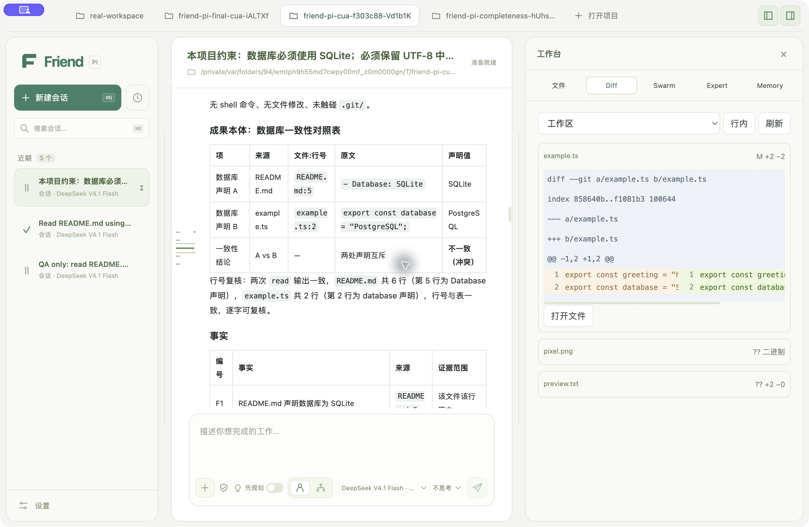

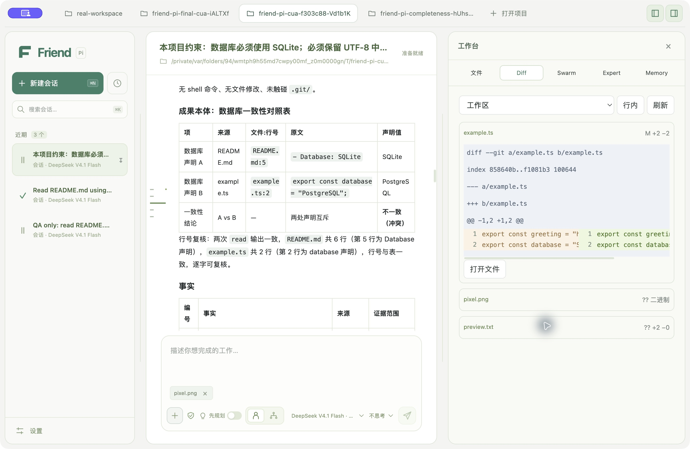

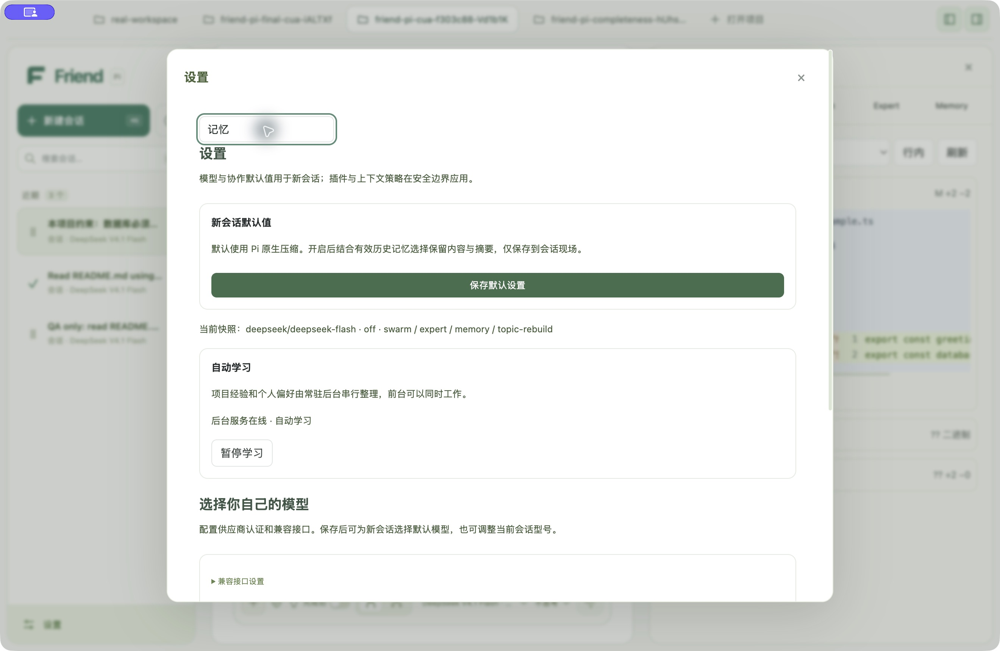

## 逐项优化

## F01 · P0 · 让成果和复核引用成为可核对的证据

证据级别：**已记录真实模型/GUI错误；本轮源码复核**。

**现在：** 上次真实 GUI 的 README 数据库声明实际第 5 行，被成员和最终报告写成第 3 行，独立复核未纠正。这是已观察问题。当前成员只上交最后一段助手文字，协调者存入 `summary`；复核只要求布尔批准、自由文本 `findings`、任务 ID 和成果版本，版本链正确仍不保证事实正确。[成员提交](/Users/youdongliang/Desktop/Friend-Pi/packages/swarm/src/member.ts:121)、[成果保存](/Users/youdongliang/Desktop/Friend-Pi/packages/swarm/src/index.ts:339)、[复核提交](/Users/youdongliang/Desktop/Friend-Pi/packages/swarm/src/member.ts:79)。

**参考：** Codex 的 ReviewFinding 有文件路径、行范围、优先级和置信度，其展示器从结构化位置渲染引用。[固定版本 schema](https://github.com/openai/codex/blob/afb436df8b70bb5bc57b86d9a3e829968988cd21/codex-rs/protocol/src/protocol.rs#L3497-L3539)、[展示器](https://github.com/openai/codex/blob/afb436df8b70bb5bc57b86d9a3e829968988cd21/codex-rs/protocol/src/review_format.rs#L5-L10)。

**适配：** 增加普通业务证据对象：任务/尝试/成果版本、原生工具条目 ID、路径、完整文件或段落摘要、引用片段。宿主从实际文件定位片段和行号，模型选择证据 ID，不再自行算行号；修改后旧证据明确失效。复核必须说明它核对了哪些成果证据；结果与证据冲突时不给“已核验”标识。右侧仍简短：成果摘要＋可点开的「2 处证据」，点开进入文件定位，不新增管理页。

**验证：** 用第 3 行诱导、第 5 行真实值、多次重复片段、CRLF、中文、文件在复核后变化、伪造工具 ID 测试；错误位置不得获“已核验”。再补同候选真实只读旅程。

**局限：** Codex 的结构化定位本身不能证明语义正确；自动原文匹配和版本核验是 Friend-Pi 的新增设计。查到真实片段也不能证明模型推论正确，推论需另有检查。

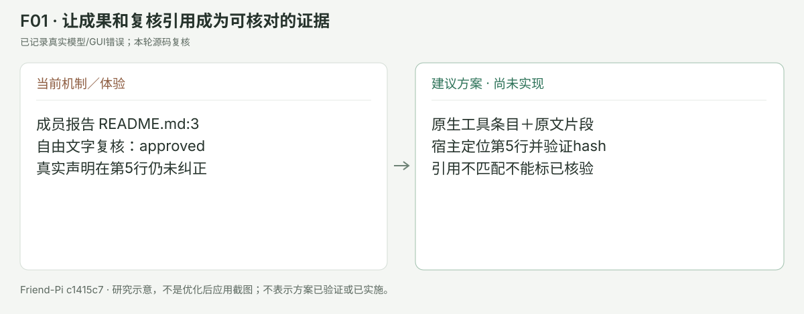

## F02 · P0 · 将“可整合”与“功能验证通过”分开

证据级别：**源码确认机制；故障与模型效果尚待专项复现**。

**现在：** Git 写入默认添加 `git diff --check`，用户/协调者没有提供 `checks` 时，它可以成为唯一客观检查；只读图还可以没有客观检查。此机制源码确认，并不是已复现坏代码自动合并。[检查组装](/Users/youdongliang/Desktop/Friend-Pi/packages/swarm/src/index.ts:414)、[采用复核](/Users/youdongliang/Desktop/Friend-Pi/packages/swarm/src/index.ts:424)、[整合门槛](/Users/youdongliang/Desktop/Friend-Pi/packages/swarm/src/index.ts:458)。`diff --check` 核对空白错误，不能替代构建、测试或真实任务断言。

**参考：** Codex 分开表达执行结果、退出码与结构化审查结论；它没有因为一条命令正常退出就给所有目标功能提供证明。[执行结果事件](https://github.com/openai/codex/blob/afb436df8b70bb5bc57b86d9a3e829968988cd21/codex-rs/protocol/src/protocol.rs#L3596-L3641)、[审查结论](https://github.com/openai/codex/blob/afb436df8b70bb5bc57b86d9a3e829968988cd21/codex-rs/protocol/src/protocol.rs#L3497-L3525)。

**适配：** 规划时记录可验证的验收条件及其检查类型；对已识别的项目，读取现有 package/构建配置，形成冻结检查策略，用已授权范围内的构建/测试命令执行。只读任务采用可机械验证的文件、值、片段断言。没有适用检查时准确显示“已完成执行／缺少功能验证”，保留成果和明确是否允许整合的配置，避免 integrated 自动被描述成正确性保证。保留完整检查日志为可回查产物，聊天中仅显示摘要、退出码和入口。

**验证：** 空白检查通过但 TypeScript 编译失败、脚本不存在、检查超时、取消、运行中基线变化、只读错误断言，均不能宣称功能验证通过；用隔离小项目补真实模型写入→独立工作区→检查→合并旅程。

**局限：** 项目脚本也可能包含副作用，不能盲目执行所有 scripts。检查策略需沿用现有权限/关键确认；测试通过仅证明覆盖的行为，不能保证所有需求。

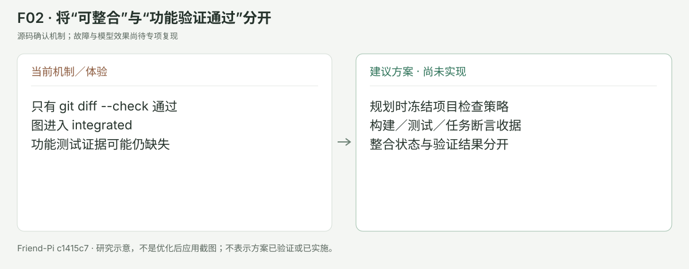

## F03 · P1 · 用一次事件等待替代模型反复查询协作进度

证据级别：**源码确认机制；故障与模型效果尚待专项复现**。

**现在：** 调度器已经由成员事件推动，SDK 也有运行权威。本轮没有发现调度器本身忙轮询错误。剩余问题在模型工具：动作列表只有 `snapshot`，工具说明要求启动/复核后继续 snapshot；协调模型容易产生多次同样查询，或尝试用 Bash sleep。[动作/说明](/Users/youdongliang/Desktop/Friend-Pi/packages/swarm/src/index.ts:486)、[真实成员事件](/Users/youdongliang/Desktop/Friend-Pi/packages/swarm/src/index.ts:293)。

**参考：** Codex 等待订阅活动，区分邮箱更新、用户 steering、超时；DSH TeamActivity 使用可取消的一次等待，并清理监听器。[Codex wait](https://github.com/openai/codex/blob/afb436df8b70bb5bc57b86d9a3e829968988cd21/codex-rs/core/src/tools/handlers/multi_agents_v2/wait.rs#L171-L188)、[DSH activity](https://github.com/deepseek-ai/deepseek-harness/blob/5badb15009ae1756c3afe0ae0cef1faafc290ccc/packages/experimental/agent-team/src/activity.ts#L22-L65)。

**适配：** 普通 controller 新增 `wait({graphId,afterRevision,timeoutMs})`：先核对持久图版本，再订阅变更，再次核对，避免丢唤醒；状态改变、需确认、用户停止/新输入、有限超时才返回。Pi 工具执行期间取消信号贯穿等待，空闲后会话仍由 Pi 接受下一次动作。不持 SQLite 锁，不加额度策略，GUI 继续用原有事件推送。

**验证：** 订阅前后完成竞态、重复事件、停止、成员崩溃、数据库恢复、10 个等待者、运行时关闭均能有界结束，监听器归零。正常 30 秒任务不再每秒产生模型 snapshot 工具调用。

**局限：** DSH 的所在目录是 experimental，不可直接称整个 Team 生产成熟；可借鉴小的 waiter 逻辑。等待进程重启后需要重查持久图；不能把内存通知当状态权威。

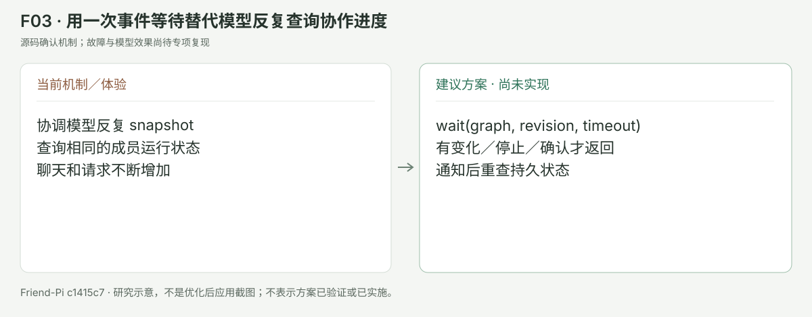

## F04 · P0 · “经过验证的经验”采用结构化工具证据门槛

证据级别：**源码确认机制；故障与模型效果尚待专项复现**。

**现在：** Memory 已校验可信用户输入、精确来源、脱敏、版本、冲突和晚结果，这是已有进步。尚存薄弱点：公共 HistoryItem 只投影 role/text，去掉了 toolName、toolCallId、isError/结果 details；Dream 可把“不包含 error/失败字样的 toolResult”作为经验的客观来源。[投影](/Users/youdongliang/Desktop/Friend-Pi/packages/core/src/index.ts:99)、[发布门槛](/Users/youdongliang/Desktop/Friend-Pi/packages/memory/src/index.ts:515)。由此推断：读取一段写着“成功”的文档与真正执行成功的检查很难区分；本轮未调用模型复现。

**参考：** Codex 保留工具调用/输出关联与来源层级，执行结束事件包含 exit_code；Memory 原史材料亦区分人类、其他 Agent、环境和工具。[来源分层](https://github.com/openai/codex/blob/afb436df8b70bb5bc57b86d9a3e829968988cd21/codex-rs/memories/write/src/rollout_input.rs#L27-L35)、[执行结果](https://github.com/openai/codex/blob/afb436df8b70bb5bc57b86d9a3e829968988cd21/codex-rs/protocol/src/protocol.rs#L3596-L3641)。

**适配：** 从 Pi 原史读出轻量证据元数据，SQLite 只存可重建引用；经验标记为观察／执行成功／客观断言通过。工具成功≠方案成功，`read` 可支持“文件里有此内容”，不能单独支持“方法解决问题”；自动 active 经验须有对应检查或可信用户明确确认。仍全自动管理，未满足条件仅内部候选，不让用户点采用。Expert 客观验证门槛继续保持。

**验证：** `read` 读到“测试全通过”、退出码 1 且没有英文 error、取消后部分输出、助手自述、真正 exit 0 检查及与产物版本不匹配的旧结果，分别得到准确证据等级，错误经验不能自动发布。

**局限：** 自定义工具未提供结构化结果时保守当观察；退出码 0 仍需与所声称的效果对应。不能凭模型输出“verified:true”升级。

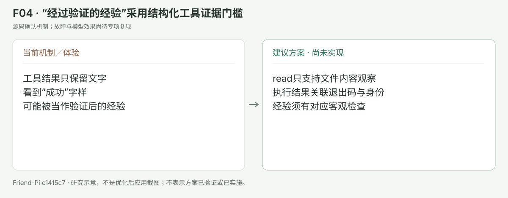

## F05 · P0 · 只对实际学习过的原文推进覆盖水位

证据级别：**源码确认机制；故障与模型效果尚待专项复现**。

**现在：** 学习入队最多 80 条消息，Reflection 单条截 6000 字符、整体 JSON 再截 90000；成功后 cursor 却记录 job 全部来源 ID。[入队](/Users/youdongliang/Desktop/Friend-Pi/packages/memory/src/index.ts:412)、[选材](/Users/youdongliang/Desktop/Friend-Pi/packages/memory/src/index.ts:470)、[覆盖推进](/Users/youdongliang/Desktop/Friend-Pi/packages/memory/src/index.ts:453)。这确认的是源码机制；潜在问题是未送到模型的长消息尾部/后续来源被视为已处理，未以新模型旅程复现。显式项目规则有全量可信原文规范化，并不说明其他经验全量覆盖。

**参考：** Codex 先按来源/预算选材并明确 omission，再按 UTF-8 边界把已选证据分消息；MiMo 对 checkpoint 的覆盖点和待处理输入分开。[Codex extraction](https://github.com/openai/codex/blob/afb436df8b70bb5bc57b86d9a3e829968988cd21/codex-rs/memories/write/src/rollout_input.rs#L199-L259)、[MiMo 待处理范围](https://github.com/XiaomiMiMo/MiMo-Code/blob/6babeb0b98f9b4818bddf04a4331edfee04dbf85/packages/cli/src/session/checkpoint.ts#L609-L613)。

**适配：** 一个串行队列任务可以有多个有界 chunk，记录真正提供的 entry/span/hash；不对序列化 JSON 做字符硬截断。提交产物与 span 覆盖原子保存，未覆盖片段继续入队，删除/纠正仍用来源 epoch/租约 fencing。必要时明确记“仅索引、不提炼”而非假称已学全部。保持后台可与前台并行，无须用户管理 chunk，也不要求前台等队列。

**验证：** 规则/经验只在第 6001 字后、80 条长工具结果之后、JSON 截断位置后；中间退出重启、修改/删除来源、晚到结果、相邻片段重复。逐字覆盖收据无遗漏，且不重放用户工具。

**局限：** 完整送入学习窗口不等于模型提取全部知识；报告要分别统计 source-covered 与 knowledge-selected。Codex 本身也允许预算省略，不能把它当不丢知识保证。

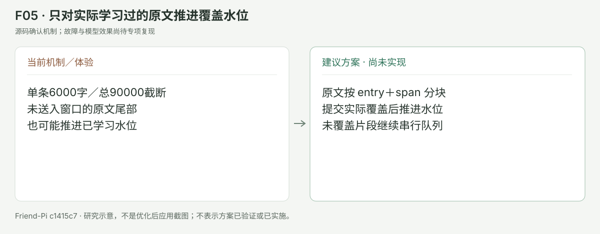

## F06 · P1 · 召回完整事实，统一预算与省略原因

证据级别：**源码确认机制；故障与模型效果尚待专项复现**。

**现在：** 查询取最近用户 text 的前 200 字，候选最多 4 条；提供给前台时每条直接 `slice(0,1000)`，总计 3000 字符。正文尾部的适用条件/例外可能被切掉；较长用户消息真正目标在后部时也可能召回无关内容。[选择](/Users/youdongliang/Desktop/Friend-Pi/packages/memory/src/index.ts:537)、[实际注入片段](/Users/youdongliang/Desktop/Friend-Pi/packages/memory/src/index.ts:580)、[查询](/Users/youdongliang/Desktop/Friend-Pi/packages/memory/src/index.ts:590)。Infinite 的预算校验还用 `summary.length/2` 和 retainedChars/2。[ReBuild 预算](/Users/youdongliang/Desktop/Friend-Pi/packages/topic-rebuild/src/index.ts:453)。这些是源码风险推断。

**参考：** Reasonix 的 AutoRecall 记录每项 score/freshness/reason、因条数与预算省略的数量；Codex Memory 用一致的 token estimate 处理来源材料。[召回诊断](https://github.com/esengine/DeepSeek-Reasonix/blob/63195e95a5b95c4b2c69481dea272fc4d5ce0bcd/internal/state/memory/auto_recall.go#L40-L68)、[统一预算](https://github.com/openai/codex/blob/afb436df8b70bb5bc57b86d9a3e829968988cd21/codex-rs/memories/write/src/rollout_input.rs#L1-L4)。

**适配：** 查询用可信 typed input＋当前目标的可追溯关键词；召回保存原子事实，或使用事先核对来源的简短摘要，禁止在限定条件中间切断。短索引＋按需 read 原文即可保留轻量界面。统一使用固定 Pi 提供的预算估计能力，取不到时保守估计并留下 fallback 诊断；注入收据记录真正片段 hash 和 omitted reason。Memory 页显示“本轮提供的 2 条”即可，评分细节只在设置诊断。

**验证：** 一条 1001 字记忆第 1000 字后才有“只限测试环境”，长中文与英文代码对照、小 context model、末尾目标、附件噪声、重复题材。注入不得截掉适用限制，预算失败能保持 native fallback。

**局限：** token estimate 仍可能不等于 Provider 精确 token 数；不引入向量数据库，不改 Pi 原生压缩默认行为，也不据召回命中宣称模型实际采用。

## F07 · P1 · 给易变项目事实增加自动再核对机制

证据级别：**源码确认机制；故障与模型效果尚待专项复现**。

**现在：** 记忆有 createdAt/updatedAt、revision、source hash，但没有 lastVerifiedAt、易变性或有效条件；源消息仍存在只能证明“当时说过”，不能证明代码、端口、脚本和分支现在仍是这样。[数据模型](/Users/youdongliang/Desktop/Friend-Pi/packages/memory/src/index.ts:15)、[搜索](/Users/youdongliang/Desktop/Friend-Pi/packages/memory/src/index.ts:364)。这属于可优化的缺项，不是来源身份错误。

**参考：** Reasonix 将 evergreen/stable/volatile 分开；硬 expires_at 排除自动召回，LastVerifiedAt 可以更新时效。[固定版本 freshness](https://github.com/esengine/DeepSeek-Reasonix/blob/63195e95a5b95c4b2c69481dea272fc4d5ce0bcd/internal/state/memory/freshness.go#L17-L97)。

**适配：** 对工具观察的文件路径、脚本存在、Git HEAD、运行资源记 freshness/verification target；使用前以只读工具自动再查，变化时记录新版本及历史关系。稳定用户偏好和明确项目规则不按时间自动遗忘；运行资源离开对应执行身份后自动失效。仍由系统管理，工作台只显示“已核对／待核对”的简短状态，不要求用户设置衰减参数。

**验证：** 删除/移动文件、改 package scripts、换分支、重启端口变化、外部修改，以及半年未改的稳定 UTF-8 规则。前四者不盲用旧事实，最后一项不因时间被悄悄删除。

**局限：** 不复制 Reasonix 的 7/30/90 天默认值；时间仅是再核对提示，不是正确性判断。原史 hash 与当前工作区 hash 必须分开。

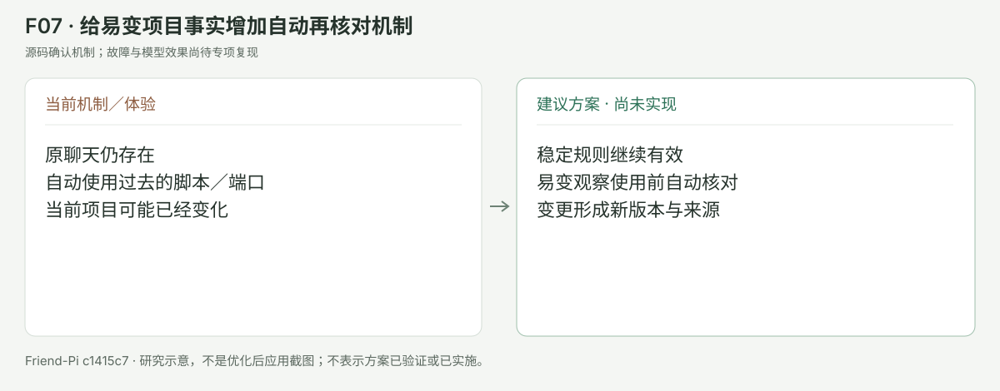

## F08 · P2 · 后台限流重试尊重服务端等待时间，并解释当前状态

证据级别：**源码确认机制；故障与模型效果尚待专项复现**。

**现在：** 已有最多三次失败后暂停、认证缺失不计失败和持久 nextAttemptAt；尚未利用 Retry-After，也没有公开的结构化失败分类，使用文字正则区分认证/来源/中断，其余固定指数退避。[当前处理](/Users/youdongliang/Desktop/Friend-Pi/packages/memory/src/index.ts:455)、[普通 complete 桥接](/Users/youdongliang/Desktop/Friend-Pi/packages/core/src/index.ts:164)。不重报为“无限重试”或“没有暂停”。

**参考：** MiniMax Code 把逻辑调用与物理请求身份分开，记录等待/恢复/耗尽/取消，处理 Retry-After 和 jitter，并以首个可见输出作为不再静默重放的边界。[重试状态](https://github.com/MiniMax-AI/minimax-code/blob/56221c121c6e63d0e50b68f57d4abf083afed119/packages/agent-core/src/pi-turn-runner/llm-retry.ts#L56-L70)、[退避](https://github.com/MiniMax-AI/minimax-code/blob/56221c121c6e63d0e50b68f57d4abf083afed119/packages/agent-core/src/pi-turn-runner/llm-retry.ts#L887-L916)、[已可见边界](https://github.com/MiniMax-AI/minimax-code/blob/56221c121c6e63d0e50b68f57d4abf083afed119/packages/agent-core/src/pi-turn-runner/llm-retry.ts#L458-L470)。

**适配：** 首先使用固定 Pi 已有公开 Provider 错误/响应钩子能提供的状态，不复刻 Agent loop。后台任务保持三次上限，遵循有效的服务端等待时间，加入有限 jitter 和单次请求时限；公开小型 job retry receipt，设置显示“限流，预计 45 秒后重试／需要配置／已暂停”。前台开始工作不取消后台；退出检查点、租约和原子发布规则不变。

**验证：** 429 Retry-After 秒/日期、503、401、无 header、等待中退出、错误文本中碰巧有 credential、阶段提交后取消，确保不忙重试、不误标配置、不重复发布/重放工具。

**局限：** 若 Pi 固定版本只暴露字符串错误，不能凭 regex 伪造 HTTP 分类或服务端等待时间；可先完成状态解释，结构化适配另行验证。MiniMax 自带框架闭包较大，仅取有限逻辑，不整套装入。

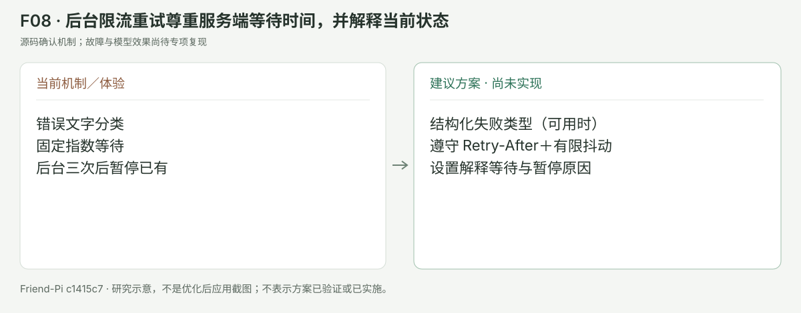

## C01 · P0 · 给工作台异步请求加项目与选择版本屏障

证据级别：**源码确认机制；竞态/性能效果需专项复现**。

**当前源码：** [apps/desktop/src/renderer/Workbench.tsx:12](/Users/youdongliang/Desktop/Friend-Pi/apps/desktop/src/renderer/Workbench.tsx:12)、[apps/desktop/src/renderer/Workbench.tsx:13](/Users/youdongliang/Desktop/Friend-Pi/apps/desktop/src/renderer/Workbench.tsx:13)、[apps/desktop/src/renderer/Workbench.tsx:18](/Users/youdongliang/Desktop/Friend-Pi/apps/desktop/src/renderer/Workbench.tsx:18)

**现在的问题：** 读取 A 项目或文件 A 后很快切到 B，晚到的 A 响应仍调用 setTabs/setSelected/setData；可能把旧项目内容显示在新项目标题下，或让旧选择抢回焦点。是源码可确定的无屏障路径，尚未做延迟注入运行复现。

**推荐处理：** 用 projectId + requestEpoch + path/scope/runId 标识请求；项目/会话改变递增 epoch；晚结果仅可进入自己的缓存，不能改当前选择。支持 AbortSignal 的接口同时取消，主进程仍验证路径和项目身份。

**复用方式：** 参考行为，React 本地实现；不复制 Solid 的上下文依赖

**固定源码参考：** [参考1](https://github.com/anomalyco/opencode/blob/3865c696efc97f30a34ea55b1d0ea4c26d939ecd/packages/app/src/context/file.tsx#L167-L202)、[参考2](https://github.com/anomalyco/opencode/blob/3865c696efc97f30a34ea55b1d0ea4c26d939ecd/packages/app/src/context/file/tree-store.ts#L42-L67)

**验证标准：**

- A 响应晚于 B 200ms 时只显示 B，B 的标题、内容、Diff 范围一致
- 切项目后旧错误/通知不污染新页，刷新不会抢走用户选择
- 缓存仍以项目隔离，取消请求不修改 JSONL 或业务状态

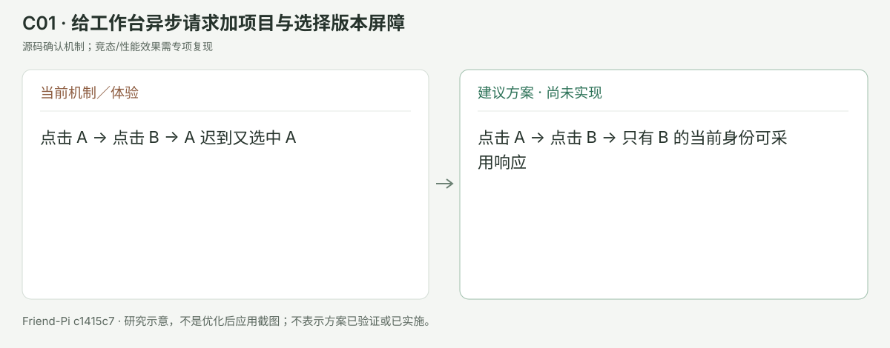

## C02 · P1 · 把扁平文件清单升级为按目录展开的只读树

证据级别：**源码确认机制；竞态/性能效果需专项复现**。

**当前源码：** [apps/desktop/src/workspace-files.ts:18](/Users/youdongliang/Desktop/Friend-Pi/apps/desktop/src/workspace-files.ts:18)、[apps/desktop/src/renderer/Workbench.tsx:15](/Users/youdongliang/Desktop/Friend-Pi/apps/desktop/src/renderer/Workbench.tsx:15)

**现在的问题：** 当前递归最多 6 层、2000 项，UI 过滤掉 directory，展示全路径扁平按钮且没有使用 truncated。大型项目容易误以为某文件不存在；同名文件与长路径难辨。

**推荐处理：** 按目录懒加载、显示层级/图标/同名路径，保留一个搜索框和少量预览标签。全项目文件查找不受已展开树限制；对忽略目录、权限错误、截断明确提示。首版不要增加编辑器或 Git 写按钮。

**复用方式：** 参考懒加载与扁平可见行模型；React 虚拟化可独立选择，不叠装 OpenCode

**固定源码参考：** [参考1](https://github.com/anomalyco/opencode/blob/3865c696efc97f30a34ea55b1d0ea4c26d939ecd/packages/app/src/context/file/tree-store.ts#L42-L138)、[参考2](https://github.com/anomalyco/opencode/blob/3865c696efc97f30a34ea55b1d0ea4c26d939ecd/packages/app/src/components/file-tree-v2.tsx#L18-L25)

**验证标准：**

- 超过 2000 文件、7 层目录仍能搜索并打开指定文件
- 相同 basename 的两份文件标签能区分，键盘上下/左右/Enter 展开定位
- 只读边界及 symlink 越界限制不放宽，深目录权限错不使整树失败

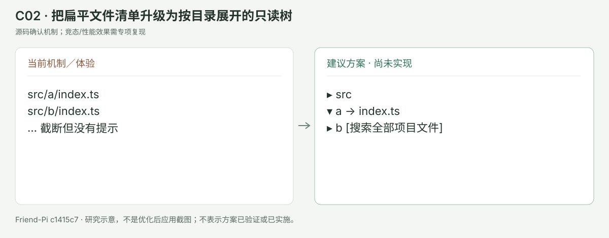

## C03 · P1 · Diff 保留现有四范围，补前后版本与成熟阅读器

证据级别：**源码确认机制；竞态/性能效果需专项复现**。

**当前源码：** [apps/desktop/src/renderer/Workbench.tsx:17](/Users/youdongliang/Desktop/Friend-Pi/apps/desktop/src/renderer/Workbench.tsx:17)、[apps/desktop/src/renderer/Workbench.tsx:18](/Users/youdongliang/Desktop/Friend-Pi/apps/desktop/src/renderer/Workbench.tsx:18)、[apps/desktop/src/workspace-files.ts:24](/Users/youdongliang/Desktop/Friend-Pi/apps/desktop/src/workspace-files.ts:24)、[apps/desktop/src/workspace-files.ts:35](/Users/youdongliang/Desktop/Friend-Pi/apps/desktop/src/workspace-files.ts:35)

**现在的问题：** 现有双栏按连续增删行位置配对，没有词内差异与逐段定位；删除文件仍提供“打开文件”但工作区文件已不存在。大文本被归入 binary 布尔值，和真正二进制共用展示。多文件/长行时阅读与跳转成本仍高。

**推荐处理：** 继续使用当前可信 Git 解析/真实本轮基线，适配 Pierre 的只读 FileDiff/File；默认折叠文件、短上下文，提供上一处/下一处、展开上下文、词内高亮、自动窄屏行内。删除打开基线只读版本，重命名可看旧/新路径；区分二进制、超预算文本、截断原因。不加入应用/回滚按钮。

**复用方式：** 可复用 @pierre/diffs 1.5.2 的 React 只读层；需要 Shiki/theme/theming/diff、worker 打包与缓存身份适配。VS Code/OpenCode 整套组件只作行为参考。

**固定源码参考：** [参考1](https://github.com/pierrecomputer/pierre/blob/d302ea0aad461a2a9ee6de5916e3482bced946e5/packages/diffs/src/react/FileDiff.tsx#L30-L67)、[参考2](https://github.com/pierrecomputer/pierre/blob/d302ea0aad461a2a9ee6de5916e3482bced946e5/packages/diffs/src/react/Virtualizer.tsx)、[参考3](https://github.com/microsoft/vscode/blob/35c48f9946eecf40beed751940607f184a03b6de/src/vs/editor/browser/widget/diffEditor/features/hideUnchangedRegionsFeature.ts#L380-L441)、[参考4](https://github.com/anomalyco/opencode/blob/3865c696efc97f30a34ea55b1d0ea4c26d939ecd/packages/session-ui/src/components/file.tsx#L1110-L1189)

**验证标准：**

- 删除文件能阅读 base；重命名能定位旧/新版本；模式/二进制仍显示明确元数据
- 空格/单词小改动可区分，特殊路径及缺尾换行保持准确
- 10k 行/100文件固定基准无全量 DOM 卡顿；窄屏自动行内，键盘可跳改动
- 切范围或更新同一文件时虚拟阅读器确实替换目标，避免依赖库旧 target 缓存

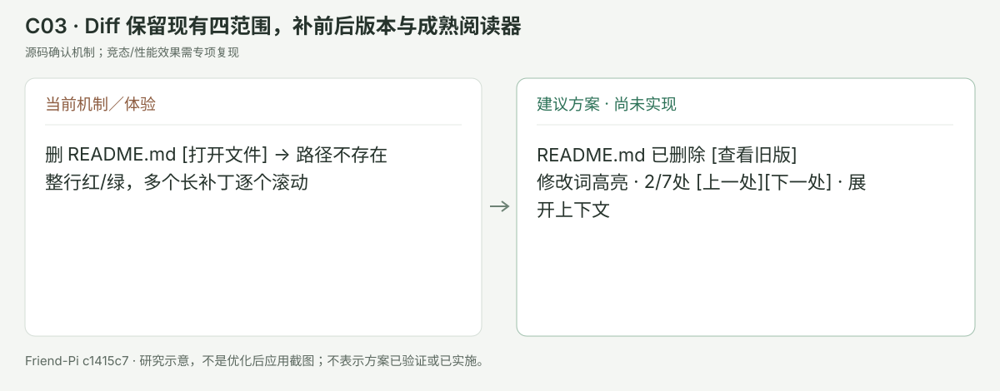

## C04 · P1 · 富文本改用完整且安全的 Markdown 解析

证据级别：**源码确认机制；竞态/性能效果需专项复现**。

**当前源码：** [apps/desktop/src/renderer/ui.tsx:32](/Users/youdongliang/Desktop/Friend-Pi/apps/desktop/src/renderer/ui.tsx:32)、[apps/desktop/src/renderer/ui.tsx:37](/Users/youdongliang/Desktop/Friend-Pi/apps/desktop/src/renderer/ui.tsx:37)、[apps/desktop/src/renderer/ui.tsx:40](/Users/youdongliang/Desktop/Friend-Pi/apps/desktop/src/renderer/ui.tsx:40)

**现在的问题：** 当前用正则/空行拆块：所有标题都变成 h3，嵌套列表/混合段落/转义竖线等不完整，代码语言被丢弃，没有复制。文件路径 decodeURIComponent 异常未做本地处理。源码表明支持子集，不能等同 CommonMark。

**推荐处理：** 采用 react-markdown + remark-gfm，关闭 raw HTML；链接走现有原生打开/受约束文件 resolver，不让解析器直接访问网络或 file://。代码块显示语言、语法颜色和复制；完成块 memo 缓存，仅增量更新未完成块。用户原话继续原文显示。

**复用方式：** Cline 是 React 但组件绑定内部 RPC/样式；优先使用同类解析库写薄适配，不照搬全部 MarkdownBlock。新增依赖需固定版本/核查子许可证。

**固定源码参考：** [参考1](https://github.com/cline/cline/blob/5b67631981ac2a3f1ad290e843a667491fb44f7d/apps/vscode/webview-ui/src/components/common/MarkdownBlock.tsx#L29-L115)、[参考2](https://github.com/cline/cline/blob/5b67631981ac2a3f1ad290e843a667491fb44f7d/apps/vscode/webview-ui/src/components/common/MarkdownBlock.tsx#L314-L335)

**验证标准：**

- 嵌套中英列表、带转义竖线/反引号表格、不同级标题与未闭代码流式稳定
- __init__.py、带空格/中文路径、错误 % 编码不会错误加粗或触发崩溃
- script/img外链/危险 scheme 不执行、不自动请求；复制不包含行号
- 同候选冷恢复和实时回复相同，既有用户输入/附件边界不变

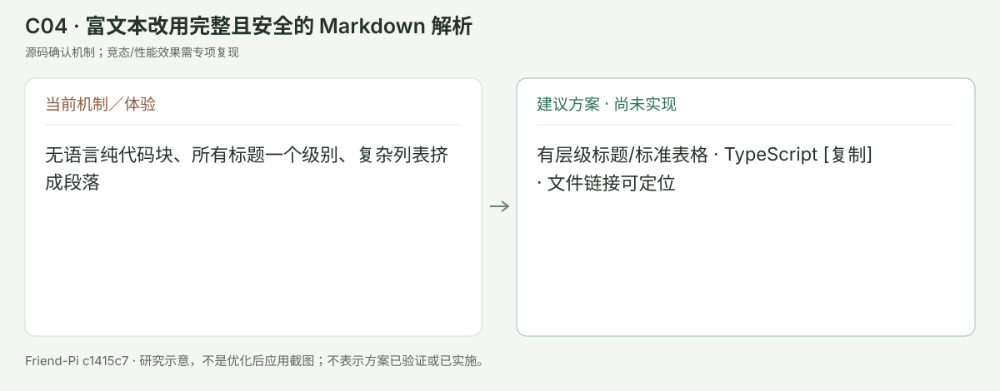

## C05 · P1 · 按原始内容顺序合并实时与历史工具，长会话只渲染可见轮次

证据级别：**源码确认机制；竞态/性能效果需专项复现**。

**当前源码：** [apps/desktop/src/message-projection.ts:5](/Users/youdongliang/Desktop/Friend-Pi/apps/desktop/src/message-projection.ts:5)、[apps/desktop/src/renderer/ui.tsx:52](/Users/youdongliang/Desktop/Friend-Pi/apps/desktop/src/renderer/ui.tsx:52)、[apps/desktop/src/renderer/App.tsx:103](/Users/youdongliang/Desktop/Friend-Pi/apps/desktop/src/renderer/App.tsx:103)、[apps/desktop/src/renderer/App.tsx:109](/Users/youdongliang/Desktop/Friend-Pi/apps/desktop/src/renderer/App.tsx:109)、[apps/desktop/src/renderer/App.tsx:219](/Users/youdongliang/Desktop/Friend-Pi/apps/desktop/src/renderer/App.tsx:219)

**现在的问题：** projection 保存了 parts，但展示先输出拼接 text 再把思考/工具集中追加，text→tool→text 的原顺序消失。tools 临时数组在 settled 后没清空，和已刷新的历史 call/result 可同时出现；且每次 token 更新映射整个历史 DOM。是源码显示风险，本轮未实测重复频率或性能。

**推荐处理：** 仍以 Pi JSONL 唯一原史，建立可重建视图 reducer：session/run/message/toolCallId 为身份，按 parts 顺序展示；历史采用后移除对应临时副本。低风险连续读取聚合为一条“读取3文件”，失败/确认突出，参数/结果/身份放展开详情。对长历史用稳定行锚点和虚拟渲染，保留用户主动滚动位置及轮次定位。

**复用方式：** 参考 reducer、分组与用户滚动状态，Pi 事件身份替代 Cline ts/epoch；不复制其按路径去重或无限 bottom overscan 的 workaround。React 虚拟列表是可选新增依赖。

**固定源码参考：** [参考1](https://github.com/cline/cline/blob/5b67631981ac2a3f1ad290e843a667491fb44f7d/apps/vscode/webview-ui/src/components/chat/chat-view/messageReducer.ts#L82-L109)、[参考2](https://github.com/cline/cline/blob/5b67631981ac2a3f1ad290e843a667491fb44f7d/apps/vscode/webview-ui/src/components/chat/chat-view/components/messages/ToolGroupRenderer.tsx#L107-L154)、[参考3](https://github.com/cline/cline/blob/5b67631981ac2a3f1ad290e843a667491fb44f7d/apps/vscode/webview-ui/src/components/chat/chat-view/components/layout/MessagesArea.tsx#L240-L265)

**验证标准：**

- 实时、停止、冷恢复同一 toolCallId 仅一条状态，结果与调用关联且原序一致
- 100+ 工具与500轮会话不会因 token 推送重复、丢图或滚动跳跃
- 展开/轮次收藏/定位状态在虚拟行进出后仍准确；不能用工具结束推断整轮完成

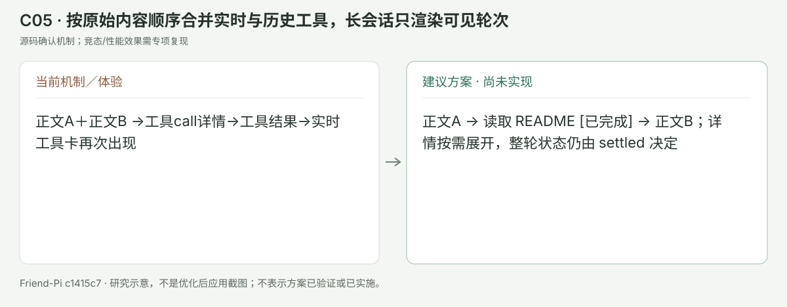

## C06 · P1 · 打通纯图片/附件入口，粘贴与拖入也用相同校验

证据级别：**本轮 GUI 复现；源代码确认**。

**当前源码：** [apps/desktop/src/renderer/App.tsx:129](/Users/youdongliang/Desktop/Friend-Pi/apps/desktop/src/renderer/App.tsx:129)、[apps/desktop/src/renderer/App.tsx:162](/Users/youdongliang/Desktop/Friend-Pi/apps/desktop/src/renderer/App.tsx:162)、[apps/desktop/src/renderer/App.tsx:222](/Users/youdongliang/Desktop/Friend-Pi/apps/desktop/src/renderer/App.tsx:222)、[apps/desktop/src/renderer/App.tsx:233](/Users/youdongliang/Desktop/Friend-Pi/apps/desktop/src/renderer/App.tsx:233)

**现在的问题：** send guard 和发送按钮都要求 draft.trim()；选择图片却没文字不能发送。当前只有文件选择器和路径胶囊，没有图像缩略、粘贴/拖入或发送前模型图像能力提示。SDK 已具备图片投影，但 UI 入口不一致。

**推荐处理：** 输入非空或有有效附件可发送；原样保留空的 userText，不伪造一句用户指令。添加缩略/读取中/过大/不支持状态；选择、粘贴、拖入共用原生受限导入与现有 SDK 校验。无图片能力时让用户换模型或移除，不静默忽略。

**复用方式：** 参考交互与类型检测；附件导入接 Electron/Pi 自身，不能复制 VS Code URI/RPC 或 Cline 忽略不支持图片的策略。

**固定源码参考：** [参考1](https://github.com/cline/cline/blob/5b67631981ac2a3f1ad290e843a667491fb44f7d/apps/vscode/webview-ui/src/components/chat/ChatTextArea.tsx#L855-L944)、[参考2](https://github.com/cline/cline/blob/5b67631981ac2a3f1ad290e843a667491fb44f7d/apps/vscode/webview-ui/src/components/chat/ChatTextArea.tsx#L1566-L1618)

**验证标准：**

- 空文本单图真实进入 Native Pi、实时和冷恢复都保留原图/空用户原话
- 多图/中文路径/过大/损坏/模型不支持时发送前给精确原因，草稿不丢
- 粘贴只响应明确用户操作，不后台读取剪贴板；附件仍不是全局偏好来源

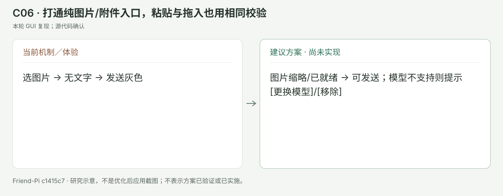

## C07 · P1 · 设置搜索覆盖完整设置，作用域固定，保护未保存修改

证据级别：**本轮 GUI 复现搜索范围问题；草稿风险来自源码**。

**当前源码：** [apps/desktop/src/renderer/App.tsx:33](/Users/youdongliang/Desktop/Friend-Pi/apps/desktop/src/renderer/App.tsx:33)、[apps/desktop/src/renderer/App.tsx:36](/Users/youdongliang/Desktop/Friend-Pi/apps/desktop/src/renderer/App.tsx:36)、[apps/desktop/src/renderer/App.tsx:39](/Users/youdongliang/Desktop/Friend-Pi/apps/desktop/src/renderer/App.tsx:39)、[apps/desktop/src/renderer/App.tsx:239](/Users/youdongliang/Desktop/Friend-Pi/apps/desktop/src/renderer/App.tsx:239)

**现在的问题：** 搜索靠 DOM textContent 隐藏部分 .field/.switch-row；可以连“设置作用域”一起隐藏，却不覆盖 settingsRoot 外四个高级管理折叠页，也留下一些无匹配按钮/说明。作用域改变 load() 会覆盖 form，没有 unsaved dirty 状态。

**推荐处理：** 仍只用一个设置弹窗，按模型/执行/学习/上下文/本地五组注册结构化设置项。搜索只显示匹配条目及所属组，结果可跳到展开的对应高级项；作用域条始终可见。每项显示继承/覆盖/当前生效/待生效；范围切换时保存或保留独立草稿，关闭时清楚提示未保存。

**复用方式：** 参考 VS Code 结构化索引和 Cline 分类/target highlight；沿用当前 React Modal，避免复制 workbench 配置系统。

**固定源码参考：** [参考1](https://github.com/microsoft/vscode/blob/35c48f9946eecf40beed751940607f184a03b6de/src/vs/workbench/contrib/preferences/browser/settingsEditor2.ts#L98-L113)、[参考2](https://github.com/microsoft/vscode/blob/35c48f9946eecf40beed751940607f184a03b6de/src/vs/workbench/contrib/preferences/browser/settingsEditor2.ts#L209-L250)、[参考3](https://github.com/cline/cline/blob/5b67631981ac2a3f1ad290e843a667491fb44f7d/apps/vscode/webview-ui/src/components/settings/SettingsView.tsx#L230-L277)

**验证标准：**

- 搜记忆/无限/专家/并发均能定位真实项，0结果清晰；作用域始终可操作
- 全局与项目脏表单不互相覆盖；不会将默认值误称当前执行快照
- 设置返回原工作台后保留材料/滚动，不增加新的常驻导航页面

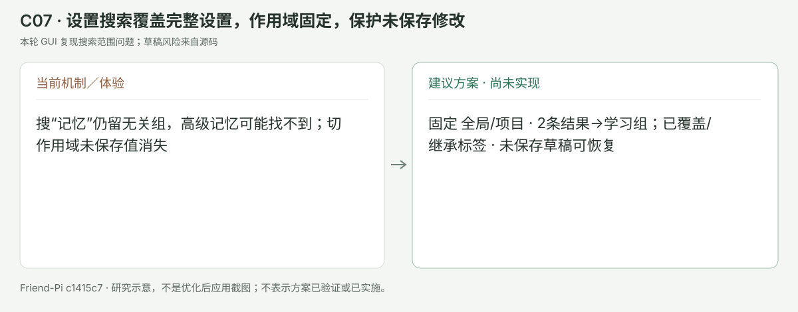

## C08 · P2 · 保持快捷归档/删除规则，给归档撤销与会话键盘导航

证据级别：**源码确认机制；竞态/性能效果需专项复现**。

**当前源码：** [apps/desktop/src/renderer/App.tsx:172](/Users/youdongliang/Desktop/Friend-Pi/apps/desktop/src/renderer/App.tsx:172)、[apps/desktop/src/renderer/App.tsx:173](/Users/youdongliang/Desktop/Friend-Pi/apps/desktop/src/renderer/App.tsx:173)、[apps/desktop/src/renderer/App.tsx:204](/Users/youdongliang/Desktop/Friend-Pi/apps/desktop/src/renderer/App.tsx:204)、[apps/desktop/src/renderer/App.tsx:240](/Users/youdongliang/Desktop/Friend-Pi/apps/desktop/src/renderer/App.tsx:240)

**现在的问题：** 近期列表仅名称 includes，无日期分组/匹配片段；快速归档立刻离开列表而没有撤销。右键菜单有 menu roles，但没有完整菜单方向键/初始焦点管理。频繁会话切换会多点几次，视觉位置变化也难找。

**推荐处理：** 近期/归档时钟不改；近期按今日/较早轻分组，名称搜索可模糊匹配并标出原始用户标题片段。快捷归档显示短暂“已归档 [撤销]”，只撤销 archive 标记。键盘上下选会话、Enter打开、ShiftF10/menu键打开相同菜单，菜单可上下/Home/End/Escape，删除仍走原共用预览/一次确认。

**复用方式：** 只参考模糊搜索与日期分组；最小 fuzzy 算法或 fuse.js 均需评估。归档撤销/菜单键盘由当前控制器实现，不采用 Cline 大型独立 History 页。

**固定源码参考：** [参考1](https://github.com/cline/cline/blob/5b67631981ac2a3f1ad290e843a667491fb44f7d/apps/vscode/webview-ui/src/components/history/HistoryView.tsx#L272-L320)、[参考2](https://github.com/cline/cline/blob/5b67631981ac2a3f1ad290e843a667491fb44f7d/apps/vscode/webview-ui/src/components/history/HistoryView.tsx#L322-L359)

**验证标准：**

- 取消归档不改变原 ID/草稿/JSONL，冷恢复仍一致；永久删除没有假撤销
- 全键盘能新建/搜索/选择/归档/恢复/打开删除预览并取消
- 100会话搜索中文/错字/长标题可找到，新增/归档后焦点到邻近稳定项

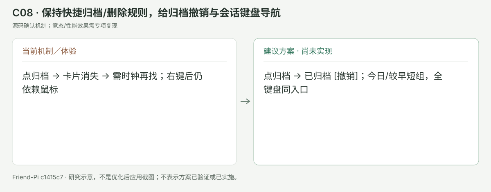

## C09 · P2 · 计划批准保留现有门槛，展示本次修订差异与执行摘要

证据级别：**源码确认机制；竞态/性能效果需专项复现**。

**当前源码：** [apps/desktop/src/renderer/App.tsx:214](/Users/youdongliang/Desktop/Friend-Pi/apps/desktop/src/renderer/App.tsx:214)、[apps/desktop/src/plan-store.ts:8](/Users/youdongliang/Desktop/Friend-Pi/apps/desktop/src/plan-store.ts:8)、[apps/desktop/src/plan-store.ts:9](/Users/youdongliang/Desktop/Friend-Pi/apps/desktop/src/plan-store.ts:9)

**现在的问题：** 现有精确版本/hash/配置批准规则正确；客户端短卡只有 vN 和全文入口。多次要求修改后，用户要重新读整篇才知道改了哪里，卡片也没帮助区分“规划中的回答”和实际提交的计划。

**推荐处理：** 只在真正提交版本时显示批准卡；卡片放3项以内执行范围/验证/风险摘要及“相比上版”的增加/移除计数。全文和前后 Diff 留在文件页，当前按钮明确“批准 v3 并执行”；配置变化显示重规划原因。摘要是可重建展示，不替代已批准 body/hash，不添加模型自动批准。

**复用方式：** 参考 Cline 区分计划模式回答的轻提示，版本差异可用 C03 阅读器；Cline 的计划结束显示不能当作 Friend-Pi 的严格批准收据。

**固定源码参考：** [参考1](https://github.com/cline/cline/blob/5b67631981ac2a3f1ad290e843a667491fb44f7d/apps/vscode/webview-ui/src/components/chat/PlanCompletionOutputRow.tsx#L9-L29)、[参考2](https://github.com/microsoft/vscode/blob/35c48f9946eecf40beed751940607f184a03b6de/src/vs/editor/browser/widget/diffEditor/features/hideUnchangedRegionsFeature.ts#L380-L441)

**验证标准：**

- 只聊天讨论方案不会显示可批准提交；只有当前提案可批准
- 修订差异对应版本内容、0变动不虚构变化；批准后修改仍需要新批准
- 中央卡不增加长表单/工具清单；全文与版本差异仍在同一文件页

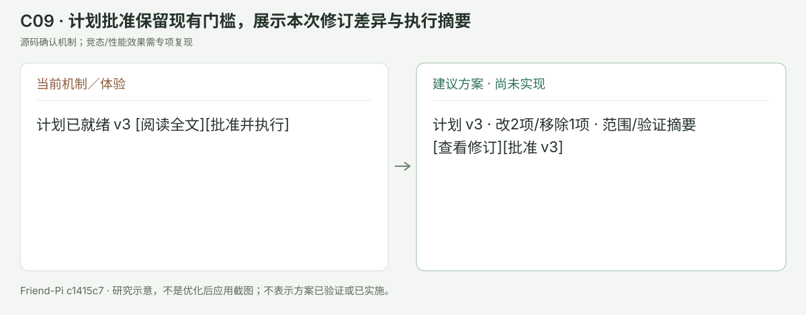

## V01 · P1 · 提高辅助文字与控制标签的可读性

证据级别：**静态 CSS 测量＋当前 GUI 观察；非全应用 WCAG 认证**。

**当前证据。** [apps/desktop/src/renderer/layout.css:38](/Users/youdongliang/Desktop/Friend-Pi/apps/desktop/src/renderer/layout.css:38) 的会话辅助文字为10px、#9bad8d，在选中背景#edf3e8上为2.12:1；[apps/desktop/src/renderer/layout.css:50](/Users/youdongliang/Desktop/Friend-Pi/apps/desktop/src/renderer/layout.css:50) 的项目路径11px为2.35:1；[apps/desktop/src/renderer/layout.css:77](/Users/youdongliang/Desktop/Friend-Pi/apps/desktop/src/renderer/layout.css:77) 模型标签10px为3.15:1。普通提示#6b7e61对白也只有4.39:1。正文#242b2a对白14.44:1，问题集中在辅助层，不是全文不可读。计算使用源码声明的纯色，尚不是所有控件/系统缩放的完整测量。

**建议。** 品牌绿#2d7258保留在主按钮、选中和成功提示；正文使用#27332d，辅助文字候选#5a655f对白为6.07:1。普通控件12–13px，正文14–15px，代码12–13px；保持用户可调字号。需要用真实字体与实际背景复核，不能只换一个全局颜色。

**参考。** [W3C 正常文字4.5:1要求](https://www.w3.org/WAI/WCAG22/Understanding/contrast-minimum)；[Zed 将工具/模型/状态按阅读层次组织](https://github.com/zed-industries/zed/blob/a34a062bb74159231af5d01cc01011f0276d9743/docs/src/ai/agent-panel.md)。这不是照抄竞品配色。

**验证。** 普通启用文字达到4.5:1；选中、hover、focus、窄屏及不同字号都可读。禁用项与纯装饰按对应例外区分；状态不只用颜色表达。

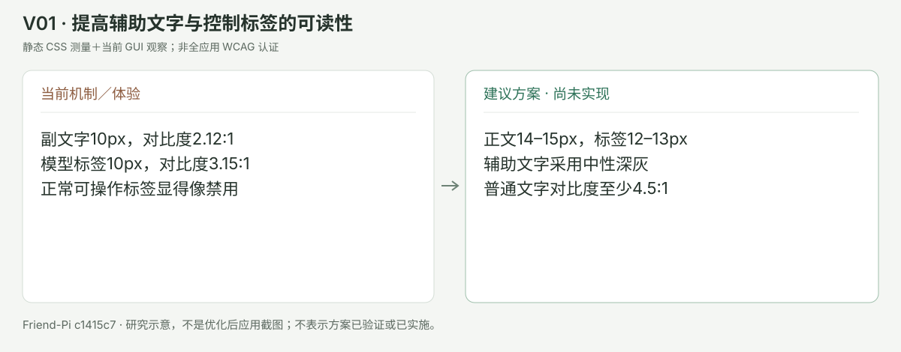

## V02 · P1 · 根据可用宽度保留主对话的阅读空间

证据级别：**实际宽窗口＋同候选上批窄窗口截图＋源码**。

**当前证据。** 当前实际截图中双栏 Diff 的两个最小220px列在工作台内需要横向滚动，Markdown表格的文件名被逐词打断。[apps/desktop/src/renderer/layout.css:3](/Users/youdongliang/Desktop/Friend-Pi/apps/desktop/src/renderer/layout.css:3) 固定最小中心320px，[apps/desktop/src/renderer/layout.css:108](/Users/youdongliang/Desktop/Friend-Pi/apps/desktop/src/renderer/layout.css:108) 在1200px以下把工作台改浮层；760px以下会话栏也浮层，两开关互不排斥。上批同候选截图确实两侧同时覆盖中央。

**建议。** 1320px宽下先尝试会话栏220–240px、工作台360–420px、中央至少520px，再根据内容调整；这组值是原型假设，待实测决定。窄屏一次显示一个浮层，关闭还原焦点；双击分隔线重置，并提供键盘重置。表格优先横向滚动或合适的列宽，不把路径拆成每字一行。

**参考。** [VS Code SplitView 的最小尺寸与分配](https://github.com/microsoft/vscode/blob/35c48f9946eecf40beed751940607f184a03b6de/src/vs/base/browser/ui/splitview/splitview.ts)和[Zed 工作/审阅区域](https://github.com/zed-industries/zed/blob/a34a062bb74159231af5d01cc01011f0276d9743/docs/src/ai/agent-panel.md)。不引入完整编辑器。

**验证。** 760/1024/1320/1600窗口检查输入、表格、长路径、双栏Diff；浮层焦点闭环、Escape、拖动/方向键、冷重启比例恢复都有效。

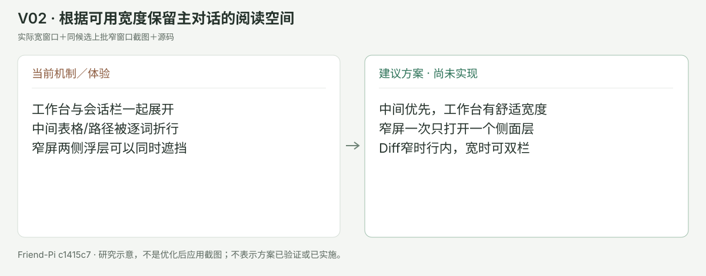

## V03 · P2 · 收敛边框、圆角和留白，区分主次操作

证据级别：**视觉评估；建议值待用户选择和实测**。

**当前证据。** [apps/desktop/src/renderer/main.tsx:3](/Users/youdongliang/Desktop/Friend-Pi/apps/desktop/src/renderer/main.tsx:3) 依次加载style、readability、layout；后面的具体选择器可覆盖前面的可读性修正。[apps/desktop/src/renderer/layout.css:18](/Users/youdongliang/Desktop/Friend-Pi/apps/desktop/src/renderer/layout.css:18)、[apps/desktop/src/renderer/layout.css:46](/Users/youdongliang/Desktop/Friend-Pi/apps/desktop/src/renderer/layout.css:46)、[apps/desktop/src/renderer/layout.css:61](/Users/youdongliang/Desktop/Friend-Pi/apps/desktop/src/renderer/layout.css:61)、[apps/desktop/src/renderer/layout.css:81](/Users/youdongliang/Desktop/Friend-Pi/apps/desktop/src/renderer/layout.css:81) 对多层容器都设独立边框/圆角；绿色文字、底色、边框同时承担太多层级。这是设计评估，不是功能故障。

**建议。** 设surface/text/border/accent/state与字体/间距tokens，组件使用同一来源；主区12px、内卡8px、输入12px可作为样稿，边框多数只用于区域分割/选择/危险状态。消息正文适当紧凑，低风险工具组改一行，设置减少全部卡片式长卷。

**参考。** 本轮实际MiniMax空态的操作集中与DSH正文/过程分层；[Zed 常见操作/审阅区域](https://github.com/zed-industries/zed/blob/a34a062bb74159231af5d01cc01011f0276d9743/docs/src/ai/agent-panel.md)只作为层级参考，不照搬暗色，也不增加其外部Agent/终端。

**验证。** 先用真实长消息、计划和Diff比较同宽截图；统一样式变化不能藏掉错误、确认、归档和停止；reduced-motion仍有效。

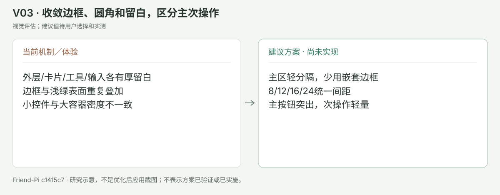

## V04 · P1 · 输入区和图标有足够点击面积，保留简洁控制

证据级别：**源码尺寸与实际 GUI；可用性建议**。

**当前证据。** [apps/desktop/src/renderer/layout.css:72](/Users/youdongliang/Desktop/Friend-Pi/apps/desktop/src/renderer/layout.css:72) 模式按钮最小26px高、文字9px；[apps/desktop/src/renderer/layout.css:98](/Users/youdongliang/Desktop/Friend-Pi/apps/desktop/src/renderer/layout.css:98) 书签只有20×20px；[apps/desktop/src/renderer/layout.css:89](/Users/youdongliang/Desktop/Friend-Pi/apps/desktop/src/renderer/layout.css:89) 轮次按钮高10px、间隔3px。不是所有小控件都必然违反目标尺寸规则，需要按间距/替代入口例外逐个检查。

**建议。** 顶部仍只保留两个镜像侧栏按钮；hover/键盘焦点清楚显示“会话栏”“工作台”。模式保持滑块，可用“单人/协作”加tooltip解释Single/Swarm，不增加独立Team。输入按短草稿收紧、长稿自适应到有限高度，并提供只扩大输入的可恢复阅读状态。轮次短线视觉不必变粗，实际命中区域/间距要扩大或用键盘替代。

**参考。** [W3C 目标尺寸与间距规则](https://www.w3.org/WAI/WCAG22/Understanding/target-size-minimum.html)；[Zed 输入展开/键盘导航](https://github.com/zed-industries/zed/blob/a34a062bb74159231af5d01cc01011f0276d9743/docs/src/ai/agent-panel.md)。

**验证。** 鼠标、触控板、Tab/方向键/Escape、中文输入法、长草稿、窄屏检查；输入展开不变成新窗口；停止按钮始终可以找到。

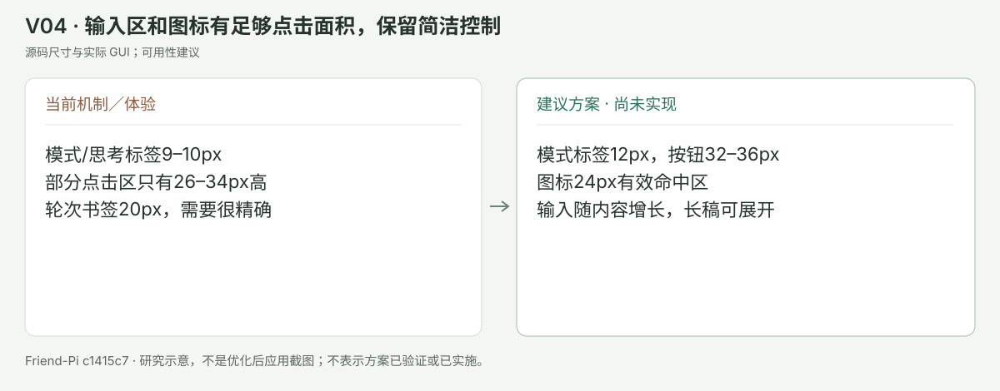

## 界面方向与决策

整体原型保留顶部横向项目、左侧会话、右上两个镜像按钮、轮次短线、输入区计划与协作控制、五个右侧轻页。默认浅色，正文与元信息改中性灰，绿色用于品牌和状态；不扩展Team、受管浏览器、终端或外部Agent后端。原型只展示交互/比例，不接模型或文件系统。

每项可以单独决定。建议先选证据与身份修复，再选阅读与设置，最后定视觉密度；不要因原型好看就绕过来源、取消、工作区、计划审批与安全边界。选中方案后，应先做针对性复现和测试，再以同候选真实模型/Computer Use验证。新的优化仍未实施。

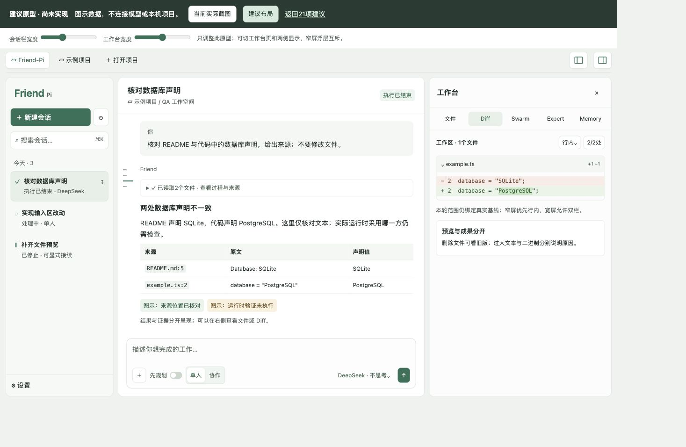

[当前与建议同宽对照](overview.html)。原型界面已用浏览器实际检查宽窗口、窄屏浮层互斥、五页切换、当前截图切换；这些仅证明研究原型可读可操作，不是应用验收。

[研究文档与原型检查记录](evidence/research-qa.json)。此记录不替代应用功能验收。
